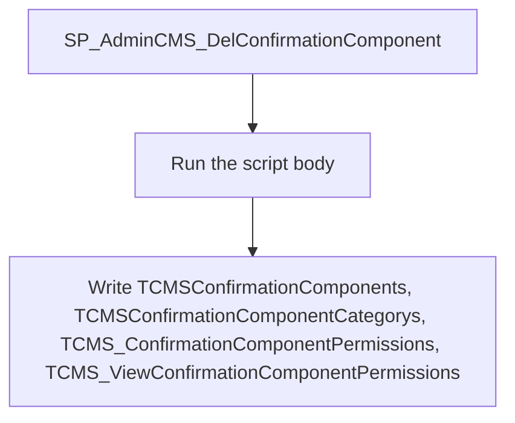

# SP_AdminCMS_DelConfirmationComponent

## What it does

Deletes an additional component and its permission and form links when employee comments do not still use it.

## Parameters

| Name | Direction | What it is for |
|---|---|---|
| `@ComponentId` | in | Component Id |
| `@Employerid` | in | Employerid |
| `@ModifiedBy` | in | Modified By |

## Call sequence

Calls no other procedures or functions.

## Callers

No other procedure or function calls this object.

## Nested

Calls no other procedures or functions.

## Steps

Script: `HRMS-DATABASE/HRMS/STOREPROCEDURE/SP_AdminCMS_DelConfirmationComponent.sql`.

1. If (Select count(1) From TCMSEmployeeComponentComments Where ComponentId=@ComponentId)>0
2. Select 1 ErrorCode
3. Update TCMSConfirmationComponents
4. Update TCMSConfirmationComponentCategorys
5. Delete from TCMS_ConfirmationComponentPermissions where ComponentId=@ComponentId;
6. Delete from TCMS_ViewConfirmationComponentPermissions where ComponentId=@ComponentId;
7. Select 0 ErrorCode

## Tables

| Table | Read or write |
|---|---|
| `TCMSConfirmationComponents` | write |
| `TCMSConfirmationComponentCategorys` | write |
| `TCMS_ConfirmationComponentPermissions` | read/write |
| `TCMS_ViewConfirmationComponentPermissions` | read/write |
| `TCMSEmployeeComponentComments` | read |

## Flow

