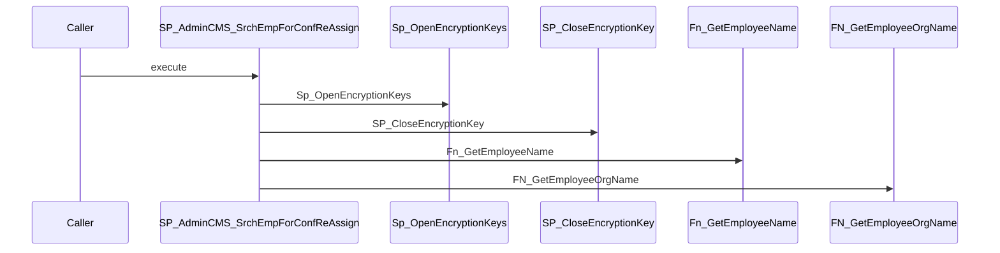
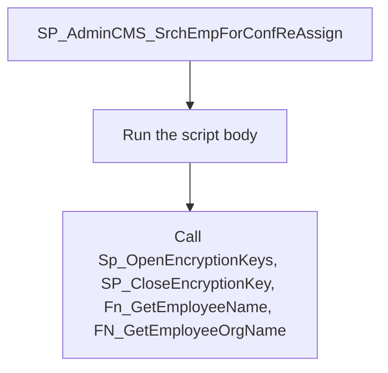

# SP_AdminCMS_SrchEmpForConfReAssign

## What it does

Searches in-progress confirmation assessments whose employee name matches the text, so an administrator can reassign the current approver.

## Parameters

| Name | Direction | What it is for |
|---|---|---|
| `@Employerid` | in | Employerid |
| `@EmployeeName` | in | Employee Name |

## Call sequence

## Callers

No other procedure or function calls this object.

## Nested

| Object | Kind | When | Page |
|---|---|---|---|
| `Sp_OpenEncryptionKeys` | procedure | during execution | [Sp_OpenEncryptionKeys](/docs/database/hrms/Sp_OpenEncryptionKeys) |
| `SP_CloseEncryptionKey` | procedure | during execution | [SP_CloseEncryptionKey](/docs/database/hrms/SP_CloseEncryptionKey) |
| `Fn_GetEmployeeName` | function | during execution | [Fn_GetEmployeeName](/docs/database/hrms/Fn_GetEmployeeName) |
| `FN_GetEmployeeOrgName` | function | during execution | [FN_GetEmployeeOrgName](/docs/database/hrms/FN_GetEmployeeOrgName) |

## Steps

Script: `HRMS-DATABASE/HRMS/STOREPROCEDURE/SP_AdminCMS_SrchEmpForConfReAssign.sql`.

1. EXEC Sp_OpenEncryptionKeys;
2. SELECT rw.Transid
3. SELECT max(approvallevel)
4. SELECT count(1)
5. SELECT EmploymentNumber
6. SELECT md.Transid
7. EXEC SP_CloseEncryptionKey

## Tables

| Table | Read or write |
|---|---|
| `TRequestWorkflows` | read |
| `Temployeeinfo` | read |
| `Temployee` | read |
| `TEmployerDetails` | read |
| `TPMSEmployerConfiguration` | read |
| `TCMSEmployeeConfirmation` | read |

## Flow

