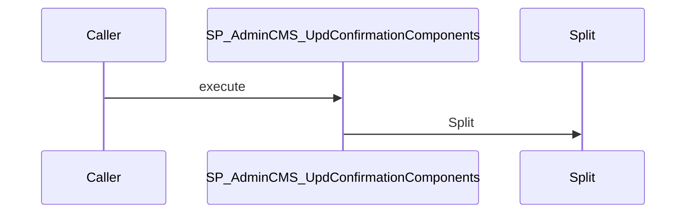
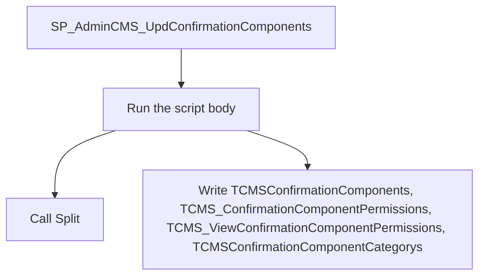

# SP_AdminCMS_UpdConfirmationComponents

## What it does

Updates an additional confirmation component, its apply-to and view levels, and the forms it belongs to, unless the script decides it is in use.

## Parameters

| Name | Direction | What it is for |
|---|---|---|
| `@ComponentId` | in | Component Id |
| `@ComponentName` | in | Component Name |
| `@ComponentType` | in | Component Type |
| `@NoofChoices` | in | Noof Choices |
| `@ChoiceText` | in | Choice Text |
| `@DisplaySequence` | in | Display Sequence |
| `@Employerid` | in | Employerid |
| `@CreatedBy` | in | Created By |
| `@IsEvidenceRequired` | in | Is Evidence Required |
| `@IsEvidenceRequiredMandatory` | in | Is Evidence Required Mandatory. Default 0 |
| `@UDTConfirmationComponentPermissions` | in | UDTConfirmation Component Permissions. Table-valued parameter |
| `@UDTViewConfirmationComponentPermissions` | in | UDTView Confirmation Component Permissions. Table-valued parameter |
| `@ViewConfirmationComponentRequired` | in | View Confirmation Component Required. Default 0 |
| `@CategoryIds` | in | Category Ids. Default '' |

## Call sequence

## Callers

No other procedure or function calls this object.

## Nested

| Object | Kind | When | Page |
|---|---|---|---|
| `Split` | function | during execution | [Split](/docs/database/hrms/Split) |

## Steps

Script: `HRMS-DATABASE/HRMS/STOREPROCEDURE/SP_AdminCMS_UpdConfirmationComponents.sql`.

1. If
2. Select 1 ErroCode, 'Component not inserted, since Component name or display order is already exists.' ErrorMsg,0 UpdateStatus
3. Update TCMSConfirmationComponents
4. Delete from TCMS_ConfirmationComponentPermissions where ComponentId=@ComponentId;
5. INSERT INTO TCMS_ConfirmationComponentPermissions (ComponentId, IsDeleted,ReviewLevelId, ReviewLevel)
6. SELECT @ComponentId,0,ReviewLevelId, ReviewLevel
7. Delete from TCMS_ViewConfirmationComponentPermissions where ComponentId=@ComponentId;
8. INSERT INTO TCMS_ViewConfirmationComponentPermissions (ComponentId, IsDeleted,ReviewLevelId, ReviewLevel)
9. SELECT @ComponentId,0,ReviewLevelId, ReviewLevel
10. Delete from TCMSConfirmationComponentCategorys where ComponentId=@ComponentId;
11. Insert Into TCMSConfirmationComponentCategorys(ComponentId,CategoryId)
12. Select @ComponentId, Data As CategoryId

## Tables

| Table | Read or write |
|---|---|
| `TCMSConfirmationComponents` | read/write |
| `TCMS_ConfirmationComponentPermissions` | read/write |
| `TCMS_ViewConfirmationComponentPermissions` | read/write |
| `TCMSConfirmationComponentCategorys` | read/write |

## Flow

