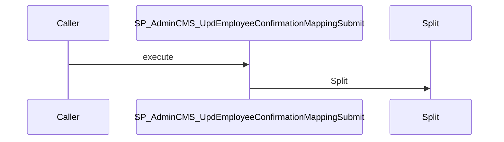
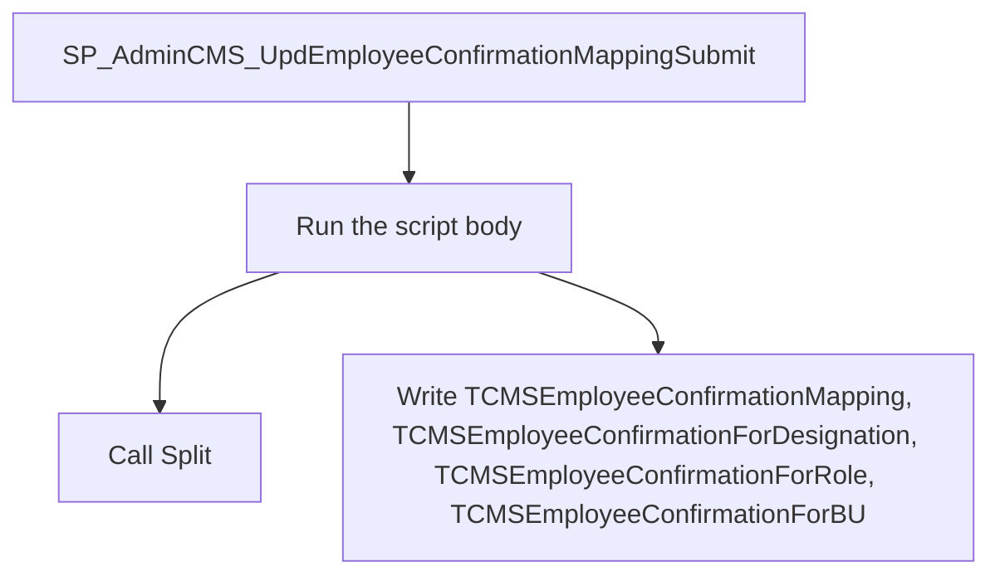

# SP_AdminCMS_UpdEmployeeConfirmationMappingSubmit

## What it does

Inserts or updates one confirmation form mapping and replaces its designation, role, and business-unit rows.

## Parameters

| Name | Direction | What it is for |
|---|---|---|
| `@ConfirmationMappingId` | in | Confirmation Mapping Id. Default 0 |
| `@CategeoryId` | in | Categeory Id |
| `@ScoreMethod` | in | Score Method. Default 'R' |
| `@RatingScaleId` | in | Rating Scale Id |
| `@EmployerId` | in | Employer Id |
| `@IsRoleSelected` | in | Is Role Selected. Default 'N' |
| `@IsDesignationSelected` | in | Is Designation Selected. Default 'N' |
| `@IsBusinessUnitSelected` | in | Is Business Unit Selected. Default 'N' |
| `@IsActive` | in | Is Active. Default 1 |
| `@CreatedBy` | in | Created By |
| `@DesignationId` | in | Designation Id. Default '' |
| `@RoleId` | in | Role Id. Default '' |
| `@BusinessUnitId` | in | Business Unit Id. Default '' |

## Call sequence

## Callers

No other procedure or function calls this object.

## Nested

| Object | Kind | When | Page |
|---|---|---|---|
| `Split` | function | during execution | [Split](/docs/database/hrms/Split) |

## Steps

Script: `HRMS-DATABASE/HRMS/STOREPROCEDURE/SP_AdminCMS_UpdEmployeeConfirmationMappingSubmit.sql`.

1. if(@ConfirmationMappingId>0)
2. Update TCMSEmployeeConfirmationMapping
3. INSERT into TCMSEmployeeConfirmationMapping (CategoryId,ScoreMethod,RatingScaleId,Employerid,IsRoleSelected,IsDesignationSelected,IsBusinessUnitSelected,IsActive,CreatedBy,Createdd
4. Select @CategeoryId,@ScoreMethod,@RatingScaleId,@Employerid,@IsRoleSelected,@IsDesignationSelected,@IsBusinessUnitSelected,@IsActive,@CreatedBy,getdate(),@CreatedBy,getdate()
5. if(@IsDesignationSelected ='Y')
6. Delete from TCMSEmployeeConfirmationForDesignation where ConfirmationMappingId = @ConfirmationMappingId
7. Insert Into TCMSEmployeeConfirmationForDesignation(ConfirmationMappingId,DesignationId)
8. Select @ConfirmationMappingId, Data As DesignationId
9. if(@IsRoleSelected ='Y')
10. Delete from TCMSEmployeeConfirmationForRole where ConfirmationMappingId = @ConfirmationMappingId
11. Insert Into TCMSEmployeeConfirmationForRole(ConfirmationMappingId,RoleId)
12. Select @ConfirmationMappingId, Data As RoleId

## Tables

| Table | Read or write |
|---|---|
| `TCMSEmployeeConfirmationMapping` | write |
| `TCMSEmployeeConfirmationForDesignation` | read/write |
| `TCMSEmployeeConfirmationForRole` | read/write |
| `TCMSEmployeeConfirmationForBU` | read/write |

## Flow

