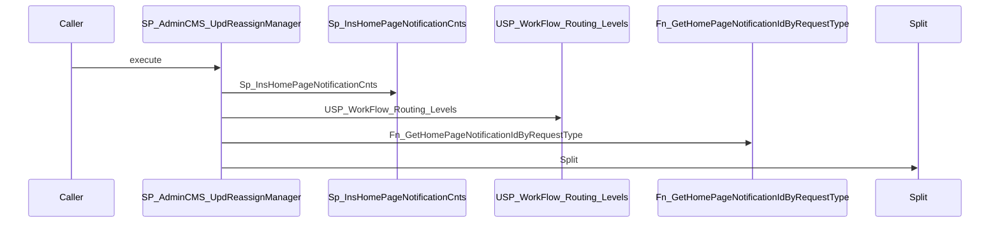
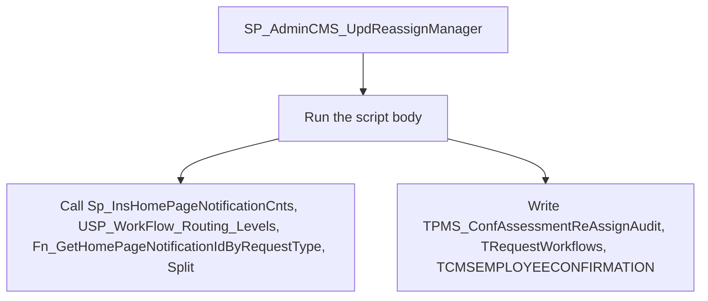

# SP_AdminCMS_UpdReassignManager

## What it does

Moves the current confirmation-assessment approver to a new manager and refreshes that request's workflow routing and homepage notification.

## Parameters

| Name | Direction | What it is for |
|---|---|---|
| `@MappingDetailsDetails` | in | Mapping Details Details |
| `@NewManagerId` | in | New Manager Id |
| `@CreatedBy` | in | Created By |

## Call sequence

## Callers

No other procedure or function calls this object.

## Nested

| Object | Kind | When | Page |
|---|---|---|---|
| `Sp_InsHomePageNotificationCnts` | procedure | during execution | [Sp_InsHomePageNotificationCnts](/docs/database/hrms/Sp_InsHomePageNotificationCnts) |
| `USP_WorkFlow_Routing_Levels` | procedure | during execution | [USP_WorkFlow_Routing_Levels](/docs/database/hrms/USP_WorkFlow_Routing_Levels) |
| `Fn_GetHomePageNotificationIdByRequestType` | function | during execution | [Fn_GetHomePageNotificationIdByRequestType](/docs/database/hrms/Fn_GetHomePageNotificationIdByRequestType) |
| `Split` | function | during execution | [Split](/docs/database/hrms/Split) |

## Steps

Script: `HRMS-DATABASE/HRMS/STOREPROCEDURE/SP_AdminCMS_UpdReassignManager.sql`.

1. Select @Lv_HomePagaNotificationId=[dbo].[Fn_GetHomePageNotificationIdByRequestType]('ConfirmationAssessment')
2. insert into @lv_RequestWorkflowTransids
3. select data from dbo.Split(@MappingDetailsDetails,',')
4. While @@FETCH_STATUS = 0
5. Select @Employerid=Employerid From Temployee Where Employeeid=@NewManagerId
6. Select @lv_ManagerId =stuff((
7. select ','+ cast(Managerid As Varchar) From TRequestWorkflows Where transid =@lv_Transid And ApproveStatus='P' FOR XML PATH('')),1,1,'')
8. Select @lv_RoutingLevel = ApprovalLevel, @lv_RequestTransId = RequestTransid, @lv_RequestOwner= RequestForEmployee, @wfId=WorkflowId
9. If @lv_ManagerId is not null
10. INSERT INTO TPMS_ConfAssessmentReAssignAudit(WFTransId,AppraisalFormId,EmployerId,OldManagerId,NewManagerId,MappingTranIdDetails,CreatedBy,CreatedDate, REASSIGNEDLEVEL)
11. Select @lv_Transid,@lv_RequestTransId, @Employerid,@lv_ManagerId,@NewManagerId,@MappingDetailsDetails,@CreatedBy, getdate(), @lv_RoutingLevel
12. Exec [dbo].[Sp_InsHomePageNotificationCnts] @lv_ManagerId,@Employerid,-1,0,@Lv_HomePagaNotificationId,'ConfirmationAssessment',@lv_Transid,'SP_UpdatecMSReassignManager','Manager Ch

## Tables

| Table | Read or write |
|---|---|
| `TPMS_ConfAssessmentReAssignAudit` | write |
| `TRequestWorkflows` | read/write |
| `TCMSEMPLOYEECONFIRMATION` | write |
| `Temployee` | read |
| `TworkflowManagement` | read |

## Flow

