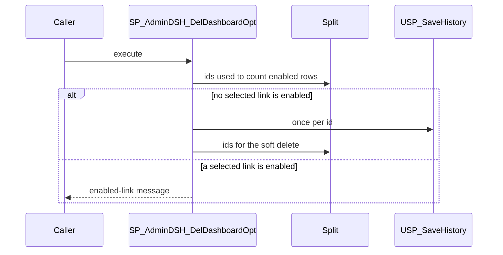
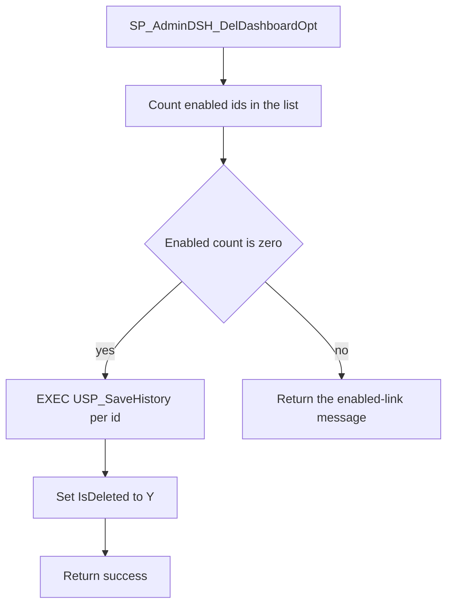

# SP_AdminDSH_DelDashboardOpt

## What it does

Soft-deletes quick links whose ids arrive as a comma-separated list. If any of those rows is enabled, it changes nothing and returns an error message that names the enabled links. When none are enabled, it writes history for each id and then sets `IsDeleted` to `Y`.

## Parameters

| Name | Direction | What it is for |
|---|---|---|
| `@Optionid` | in | Comma-separated option ids, `varchar(500)` |
| `@LastupdateBy` | in | Employee recorded on the history call and on `LastupdateBy` |

## Call sequence

## Callers

No other procedure or function calls this object.

`DefaultPageSetupDLL.RemoveDashboardOptions` executes it from Home Page Setup. That caller is application code.

## Nested

| Object | Kind | When | Page |
|---|---|---|---|
| `Split` | function | Count enabled rows, apply the soft delete, and build the refusal message | [Split](/docs/database/hrms/Split) |
| `USP_SaveHistory` | procedure | Once per id, only when no selected link is enabled. Arguments name `TDashboardOptions` and `TDashboardOptions_History` | No page yet |

`STRING_SPLIT` is also used to fill the id loop. That is a SQL Server built-in, not a nested object. The `CREATE PROCEDURE` script for `USP_SaveHistory` is not in this database folder.

## Steps

1. Count `TDashboardOptions` rows whose `Optionid` is in `dbo.Split(@Optionid, ',')` and whose `isenabled` is 1 (`SP_AdminDSH_DelDashboardOpt.sql`).
2. When that count is 0, load the ids with `STRING_SPLIT` into `#TempIds`.
3. For each id, `EXEC USP_SaveHistory` with `@MainTableName = 'TDashboardOptions'`, `@HistoryTableName = 'TDashboardOptions_History'`, `@ID = 'Optionid'`, `@ActionType = 'U'`, and `@HistoryCreatedBy = @LastupdateBy`.
4. Drop `#TempIds`.
5. Update those ids to `IsDeleted = 'Y'`, set `LastupdateBy` and `Lastupdate = getdate()`. The id list for this update comes from `dbo.Split` again.
6. Return `ErrorCode` 0 and `Errormsg` `Selected Link deleted successfully`.
7. When the enabled count is not 0, return `Errorcode` 1 and an `ErrorMsg` that concatenates the distinct `OptionName` values still enabled. No update runs.

## Tables

| Table | Read or write |
|---|---|
| `TDashboardOptions` | read, and write when no selected link is enabled |
| `TDashboardOptions_History` | named as the history target of `USP_SaveHistory`. The body of that procedure is not in this folder, so the write is not confirmed here |

## Flow

