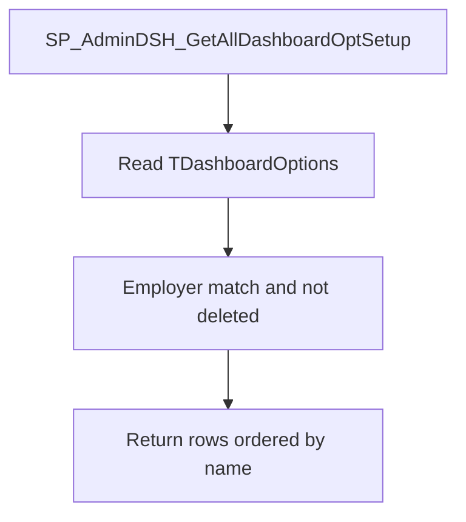

# SP_AdminDSH_GetAllDashboardOptSetup

## What it does

Returns the quick-link rows for one employer, including disabled rows, and leaves out rows whose `IsDeleted` is `Y`. The header comment says it gets all dashboard link details. Results are ordered by `OptionName`.

## Parameters

| Name | Direction | What it is for |
|---|---|---|
| `@Employerid` | in | Organisation whose links are listed |

## Call sequence

Calls no other procedures or functions.

## Callers

No other procedure or function calls this object.

`DefaultPageSetupDLL.GetAllDashboardOptionListSetup` executes it from Home Page Setup. That caller is application code.

## Nested

Calls no other procedures or functions.

## Steps

1. Select `Optionid`, `OptionName`, `OptionDescription`, `ImageSource`, `OptionCategory`, `OptionURL`, `AttachmentPath`, `IsEnabled`, `BackColor`, and `IconImage` (empty string when null) from `TDashboardOptions` (`SP_AdminDSH_GetAllDashboardOptSetup.sql`).
2. Keep rows for `@Employerid` where `ISNULL(IsDeleted, '')` is not `Y`.
3. Order by `OptionName`.

## Tables

| Table | Read or write |
|---|---|
| `TDashboardOptions` | read |

## Flow

