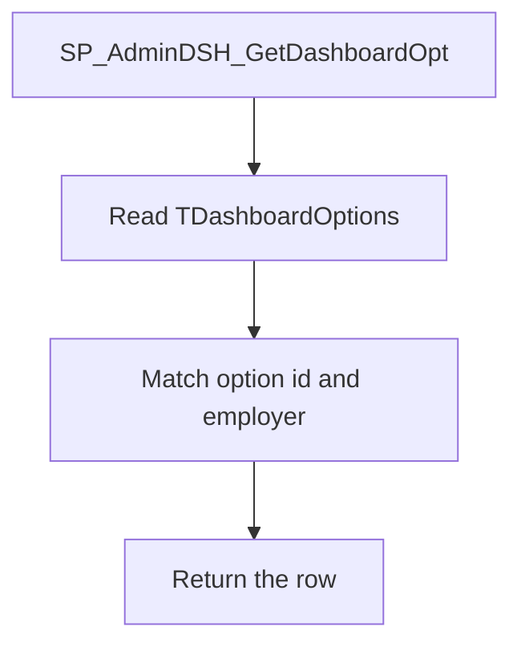

# SP_AdminDSH_GetDashboardOpt

## What it does

Returns one quick-link row for an option id and an employer. Unlike the list procedure, this read does not exclude `IsDeleted = 'Y'`.

## Parameters

| Name | Direction | What it is for |
|---|---|---|
| `@Optionid` | in | Quick-link id |
| `@Employerid` | in | Organisation that must own that id |

## Call sequence

Calls no other procedures or functions.

## Callers

No other procedure or function calls this object.

`DefaultPageSetupDLL.GetOptionDetailsByOptionId` executes it from Home Page Setup. That caller is application code.

## Nested

Calls no other procedures or functions.

## Steps

1. Select `Optionid`, `OptionName`, `OptionDescription`, `ImageSource`, `OptionCategory`, `OptionURL`, `AttachmentPath`, `IsEnabled`, `BackColor`, and `IconImage` (empty string when null) from `TDashboardOptions` (`SP_AdminDSH_GetDashboardOpt.sql`).
2. Keep the row where `Optionid` and `Employerid` both match.

## Tables

| Table | Read or write |
|---|---|
| `TDashboardOptions` | read |

## Flow

