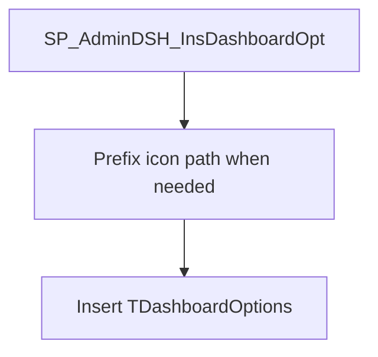

# SP_AdminDSH_InsDashboardOpt

## What it does

Inserts one quick-link row into `TDashboardOptions`. If `@IconImage` does not already start with `~\`, the procedure prefixes that string before the insert. It does not check for a duplicate name and it does not open a transaction.

## Parameters

| Name | Direction | What it is for |
|---|---|---|
| `@OptionName` | in | Link name, `varchar(100)` |
| `@OptionDescription` | in | Description, `varchar(200)` |
| `@ImageSource` | in | Card image path, `varchar(100)` |
| `@OptionCategory` | in | `A` attachment or `U` url, `char(1)` |
| `@OptionURL` | in | Url or Open File path, `varchar(500)` |
| `@AttachmentPath` | in | Stored document path, `varchar(1000)` |
| `@IsEnabled` | in | Whether the link is enabled |
| `@CreateBy` | in | Employee who created the row |
| `@Employerid` | in | Organisation that owns the link |
| `@BackColor` | in | Back color, `nvarchar(50)`. The page no longer sets it |
| `@IconImage` | in | Icon path, `nvarchar(500)` |

## Call sequence

Calls no other procedures or functions.

## Callers

No other procedure or function calls this object.

`DefaultPageSetupDLL.AddDashboardOptions` executes it from Home Page Setup. That caller is application code.

## Nested

Calls no other procedures or functions.

## Steps

1. When `@IconImage` does not match `~\%`, set `@IconImage` to `~\` plus the incoming value (`SP_AdminDSH_InsDashboardOpt.sql`).
2. Insert `TDashboardOptions` with the parameters, `CreateDate = getdate()`, and the adjusted icon path. `IsDeleted` is left to the table default.

## Tables

| Table | Read or write |
|---|---|
| `TDashboardOptions` | write |

## Flow

