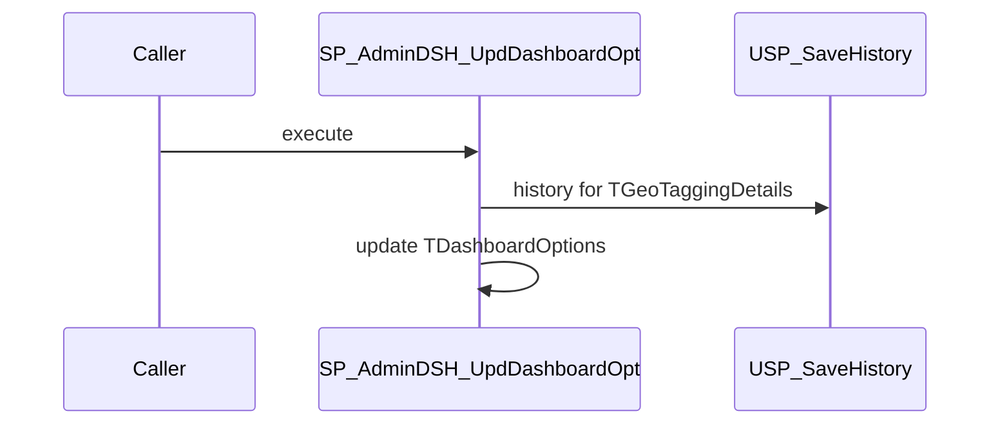
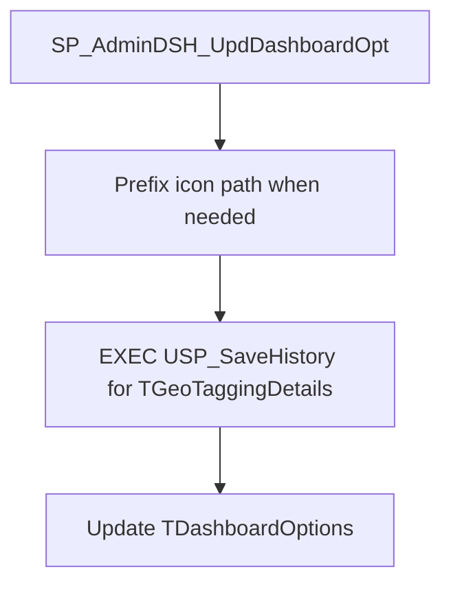

# SP_AdminDSH_UpdDashboardOpt

## What it does

Updates one `TDashboardOptions` row by `@Optionid`. It prefixes `@IconImage` with `~\` when that value does not already start that way. Before the update it calls `USP_SaveHistory` with main table `TGeoTaggingDetails` and history table `TGeoTaggingDetails_History`, using `@Optionid` as the key. The script does not mention `TDashboardOptions_History`.

## Parameters

| Name | Direction | What it is for |
|---|---|---|
| `@Optionid` | in | Row to update |
| `@OptionName` | in | Link name, `varchar(100)` |
| `@OptionDescription` | in | Description, `varchar(200)` |
| `@ImageSource` | in | Card image path, `varchar(100)` |
| `@OptionCategory` | in | `A` or `U` |
| `@OptionURL` | in | Url or Open File path, `varchar(500)` |
| `@AttachmentPath` | in | Stored document path, `varchar(1000)` |
| `@IsEnabled` | in | Whether the link is enabled |
| `@LastupdateBy` | in | Employee who saved the change. Also passed as history created-by |
| `@BackColor` | in | Back color, `nvarchar(50)` |
| `@IconImage` | in | Icon path, `nvarchar(500)` |

## Call sequence

## Callers

No other procedure or function calls this object.

`DefaultPageSetupDLL.UpdateDashboardOptions` executes it from Home Page Setup. That caller is application code.

## Nested

| Object | Kind | When | Page |
|---|---|---|---|
| `USP_SaveHistory` | procedure | Always, before the update. Arguments name `TGeoTaggingDetails` and `TGeoTaggingDetails_History` | No page yet |

The `CREATE PROCEDURE` script for `USP_SaveHistory` is not in this database folder.

## Steps

1. When `@IconImage` does not match `~\%`, prefix it with `~\` (`SP_AdminDSH_UpdDashboardOpt.sql`).
2. Read `DB_NAME()` into `@DB_Name`.
3. `EXEC USP_SaveHistory` with `@MainTableName = 'TGeoTaggingDetails'`, `@HistoryTableName = 'TGeoTaggingDetails_History'`, `@ID = 'Id'`, `@Value = @Optionid`, `@ActionType = 'U'`, and `@HistoryCreatedBy = @LastupdateBy`.
4. Update `TDashboardOptions` for that `@Optionid` and set `Lastupdate = getdate()`. The `WHERE` clause does not check `@Employerid`. This procedure has no employer parameter.

## Tables

| Table | Read or write |
|---|---|
| `TDashboardOptions` | write |
| `TGeoTaggingDetails` | named as the history source. The body of `USP_SaveHistory` is not in this folder, so the write is not confirmed here |
| `TGeoTaggingDetails_History` | named as the history target. Same limit as the row above |

## Flow

