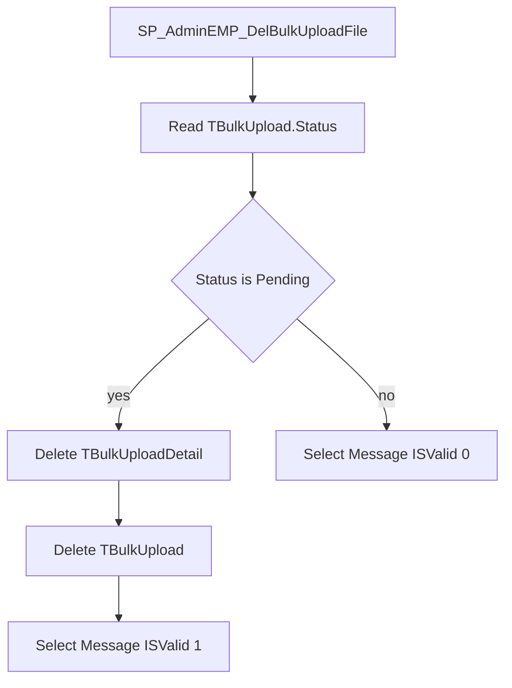

# SP_AdminEMP_DelBulkUploadFile

## What it does

Deletes a bulk document-upload batch only when its `TBulkUpload.Status` is `Pending`. On success it removes matching `TBulkUploadDetail` rows then the `TBulkUpload` row and returns `Message` plus `ISValid` `1`. For any other status it leaves the rows and returns a cannot-delete message with `ISValid` `0`.

## Parameters

| Name | Direction | What it is for |
|---|---|---|
| `@BulkId` | in | Batch id to delete when still Pending |

## Call sequence

Calls no other procedures or functions.

## Callers

No other procedure or function calls this object. `EmployeeDal.DeleteBulkUploadedFile` executes it from Bulk Document Import (`DocumentBulkImport.aspx.cs`) via `ConstantStoredProcedure.SP_Delete_BulkUploadFile`.

## Nested

Calls no other procedures or functions.

## Steps

1. In `HRMS-DATABASE/HRMS/STOREPROCEDURE/SP_AdminEMP_DelBulkUploadFile.sql`, read `Status` from `TBulkUpload` for `@BulkId`.
2. When status is `Pending`, delete `TBulkUploadDetail` for that bulk id, delete the `TBulkUpload` row, and select message `Selected Record Deleted Successfully` with `ISValid` `1`.
3. Otherwise select message `Selected Record Cannot Be Deleted As Its Not In Pending State` with `ISValid` `0`.

## Tables

| Table | Read or write |
|---|---|
| `dbo.TBulkUpload` | read, write |
| `dbo.TBulkUploadDetail` | write |

## Flow

