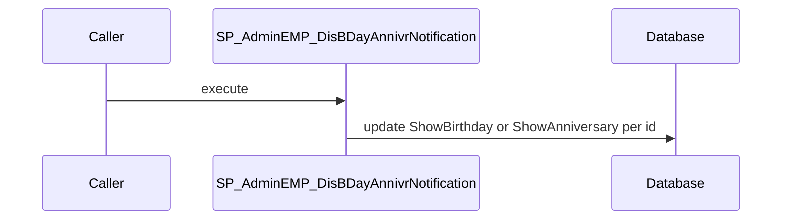
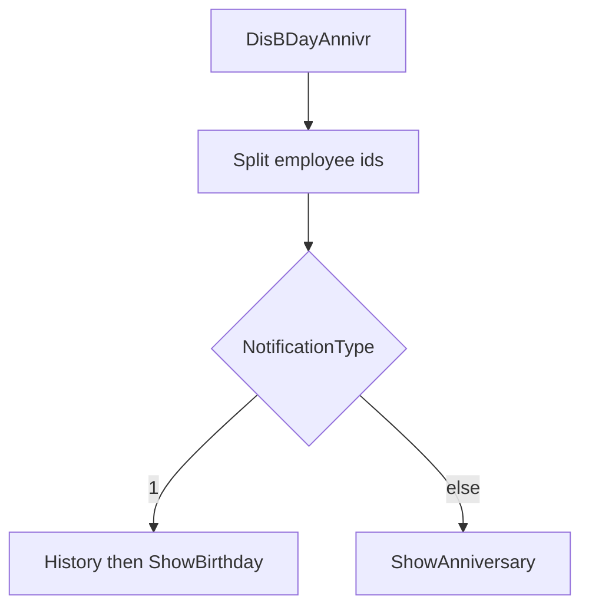

# SP_AdminEMP_DisBDayAnnivrNotification

## What it does

Enables or disables birthday (`NotificationType = 1`) or work-anniversary (other) notifications for a comma-separated list of employees. `@IsDisabled = 1` means hide (`ShowBirthday` / `ShowAnniversary = 0`). Birthday changes with `@UpdatedBy` snapshot `TEmployee` into `TEmployeeHistory` before updating; anniversary updates the flag only.

## Parameters

| Name | Direction | What it is for |
|---|---|---|
| `@EmployeeID` | in | Comma-separated employee ids |
| `@NotificationType` | in | `1` birthday; otherwise anniversary |
| `@IsDisabled` | in | `1` disable / `0` enable |
| `@UpdatedBy` | in | Actor (history when birthday and provided) |

## Call sequence

## Callers

Application caller: Search Employee footer enable/disable birthday or anniversary → SDK toggle → `toggleBirthdayAnniversaryNotification.js`.

## Nested

Uses `dbo.Split` table-valued helper; no nested procedure pages.

## Steps

1. Script is `HRMS-DATABASE/HRMS/STOREPROCEDURE/SP_AdminEMP_DisBDayAnnivrNotification.sql`.
2. Split `@EmployeeID` list.
3. For birthday, skip no-ops; optionally insert history; set `ShowBirthday`.
4. For anniversary, set `ShowAnniversary` without history.

## Tables

| Table | Read or write |
|---|---|
| `dbo.TEmployee` | read and write |
| `dbo.TEmployeeHistory` | write (birthday path) |

## Flow

