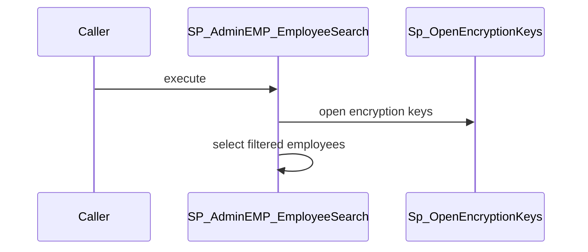
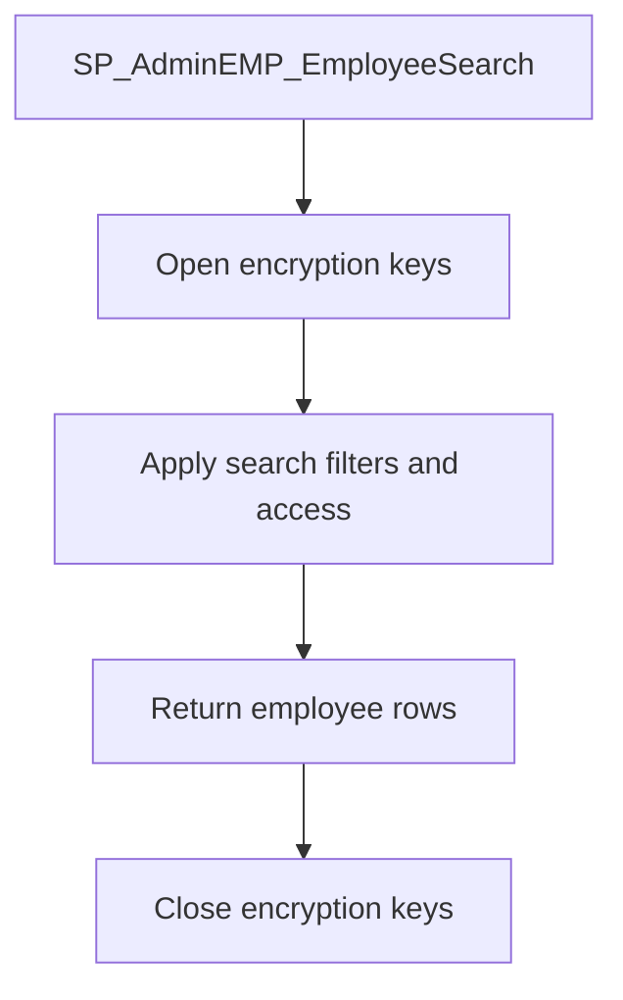

# SP_AdminEMP_EmployeeSearch

## What it does

Classic Search Employee grid query. Opens encryption keys, resolves employer cross-reporting settings, and returns matching employee rows filtered by name/TIN/org/status/skills/visa/qualification and related criteria for the login employee’s access scope.

## Parameters

| Name | Direction | What it is for |
|---|---|---|
| `@EmployeeId` | in | Optional employee id filter |
| `@EmployeeName` | in | Name / predictive search text |
| `@TINNumber` | in | Tax / PAN style identifier |
| `@PNPFNumber` | in | Provident-fund style identifier |
| `@EmployerId` | in | Selected organisation |
| `@EmployementTypeId` | in | Employment type |
| `@DepartmentId` | in | Department (legacy) |
| `@DesignationId` | in | Designation / title |
| `@PayCycleType` | in | Pay cycle |
| `@EmployeeStatus` | in | `Y` / `N` / null |
| `@PassportNumber` | in | Passport |
| `@VisaType` | in | Visa type |
| `@VisaCountry` | in | Visa country |
| `@ValidUpTo` | in | Visa validity |
| `@TrainingName` | in | Training name |
| `@Skills` | in | Skills filter |
| `@Certification` | in | Certification |
| `@QualificationId` | in | Qualification |
| `@Specializations` | in | Specialization |
| `@MedicalCondition` | in | Medical condition |
| `@MedicalDisability` | in | Medical disability |
| `@PageIndex` | in | Page index (caller may pass 0) |
| `@PageSize` | in | Page size |
| `@RecordCount` | in | Record count placeholder |
| `@SortColumn` | in | Sort column |
| `@SortDirection` | in | Sort direction |
| `@BusinessUnit` | in | Organisation unit / BU XML text |
| `@Category` | in | Skill category |
| `@LoginEmployeeId` | in | Logged-in employee for access |

## Call sequence

## Callers

Application caller: classic `SearchEmployee.aspx` via `EmployeeDal.EmployeeSearch`. New Look Search Employee does not call this procedure.

## Nested

| Object | Kind | When | Page |
|---|---|---|---|
| `Sp_OpenEncryptionKeys` / `Sp_OpenEncryptionKeysNew` | procedure | start of batch | infrastructure (no feature page) |
| `SP_CloseEncryptionKey` / `Sp_CloseEncryptionKeyNew` | procedure | end of batch | infrastructure (no feature page) |

## Steps

1. Script is `HRMS-DATABASE/HRMS/STOREPROCEDURE/SP_AdminEMP_EmployeeSearch.sql`.
2. Open encryption keys.
3. Normalize empty `@EmployeeStatus` to null; read `IsCrossReportingApplicable` from `TEmployerDetails`.
4. Build filtered employee result set using encrypted personal fields and org/access constraints for `@LoginEmployeeId`.
5. Close encryption keys.

## Tables

| Table | Read or write |
|---|---|
| `dbo.TEmployerDetails` | read |
| `dbo.TEmployee` | read |
| `dbo.TEmployeeInfo` | read |
| `dbo.TORGChart` | read |

## Flow

