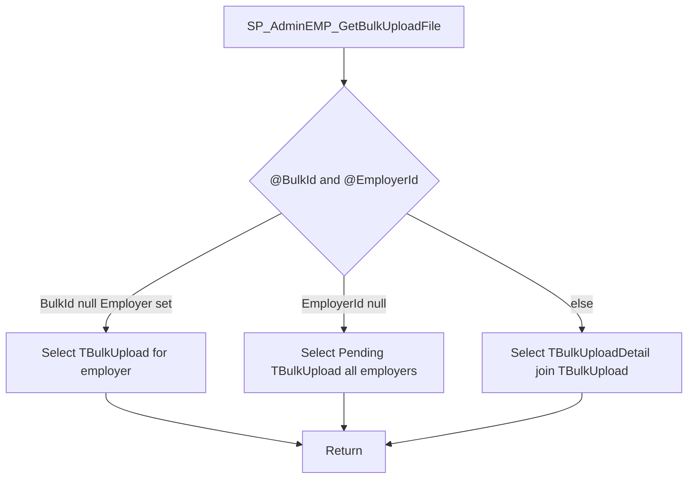

# SP_AdminEMP_GetBulkUploadFile

## What it does

Returns bulk document-upload data in three shapes. With employer and no bulk id, it lists that employer’s `TBulkUpload` batches (newest first) with category name from `TAttachmentCategory`. With neither employer nor a usable bulk path for employer-null, it lists all Pending batches across employers. With both (or a bulk id in the else branch), it returns detail rows joined to the batch, mapping detail status `S` to Success and anything else to Failure.

## Parameters

| Name | Direction | What it is for |
|---|---|---|
| `@EmployerId` | in | Optional employer filter for the batch list |
| `@BulkId` | in | Optional batch id for detail rows |

## Call sequence

Calls no other procedures or functions.

## Callers

No other procedure or function calls this object. `EmployeeDal.getBulkUploadDocuments` executes it from Bulk Document Import and `EmployeeBulkUploadDetails.aspx` via `ConstantStoredProcedure.SP_Get_BulkUploadFile`.

## Nested

Calls no other procedures or functions.

## Steps

1. In `HRMS-DATABASE/HRMS/STOREPROCEDURE/SP_AdminEMP_GetBulkUploadFile.sql`, when `@BulkId` is null and `@EmployerId` is not null, select batch columns for that employer ordered by `Uploadeddate` descending, resolving category text from `TAttachmentCategory`.
2. When `@EmployerId` is null, select Pending batches for all employers ordered by employer then upload date, with the same category subquery.
3. Otherwise select detail rows for `@BulkId` joined to `TBulkUpload`, including employment number, display name, Success/Failure status text, failure details, and category.

## Tables

| Table | Read or write |
|---|---|
| `dbo.TBulkUpload` | read |
| `dbo.TBulkUploadDetail` | read |
| `dbo.TAttachmentCategory` | read |

## Flow

