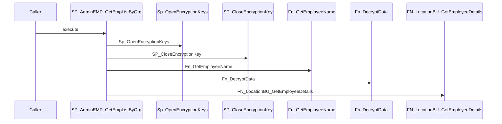
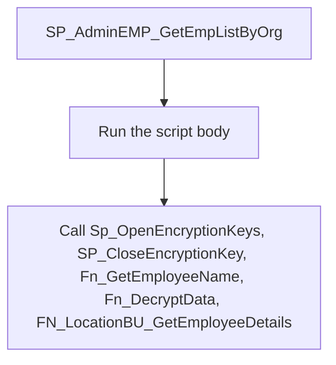

# SP_AdminEMP_GetEmpListByOrg

## What it does

Lists employees in an organisation for a picker. It opens the encryption keys, decrypts names, and closes the keys.

## Parameters

| Name | Direction | What it is for |
|---|---|---|
| `@active` | in | Active. Default 'Y' |
| `@departmentID` | in | Department ID. Default 0 |
| `@organizationId` | in | Organization Id. Default 0 |
| `@EmployeeId` | in | Employee Id |

## Call sequence

## Callers

No other procedure or function calls this object.

## Nested

| Object | Kind | When | Page |
|---|---|---|---|
| `Sp_OpenEncryptionKeys` | procedure | during execution | [Sp_OpenEncryptionKeys](/docs/database/hrms/Sp_OpenEncryptionKeys) |
| `SP_CloseEncryptionKey` | procedure | during execution | [SP_CloseEncryptionKey](/docs/database/hrms/SP_CloseEncryptionKey) |
| `Fn_GetEmployeeName` | function | during execution | [Fn_GetEmployeeName](/docs/database/hrms/Fn_GetEmployeeName) |
| `Fn_DecryptData` | function | during execution | [Fn_DecryptData](/docs/database/hrms/Fn_DecryptData) |
| `FN_LocationBU_GetEmployeeDetails` | function | during execution | [FN_LocationBU_GetEmployeeDetails](/docs/database/hrms/FN_LocationBU_GetEmployeeDetails) |

## Steps

Script: `HRMS-DATABASE/HRMS/STOREPROCEDURE/SP_AdminEMP_GetEmpListByOrg.sql`.

1. EXEC Sp_OpenEncryptionKeys
2. SELECT @IsCrossReportingApplicable=IsCrossReportingApplicable FROM TemployerDetails
3. IF @IsCrossReportingApplicable='N'
4. IF(@departmentID = 0)
5. SELECT @Lv_Root_EmployerId= RootEmployerId FROM TemployerDetails WHERE employerid=@organizationId
6. IF(@departmentID = 0)
7. EXEC SP_CloseEncryptionKey

## Tables

| Table | Read or write |
|---|---|
| `TemployerDetails` | read |
| `TOrgHierarchyDetails` | read |
| `ttitle` | read |
| `TEmployee` | read |
| `TEmployeeInfo` | read |

## Flow

