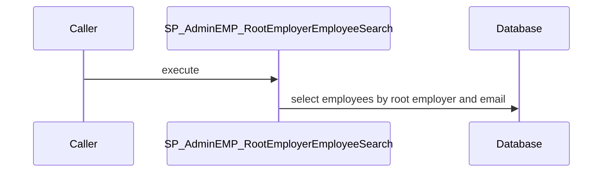
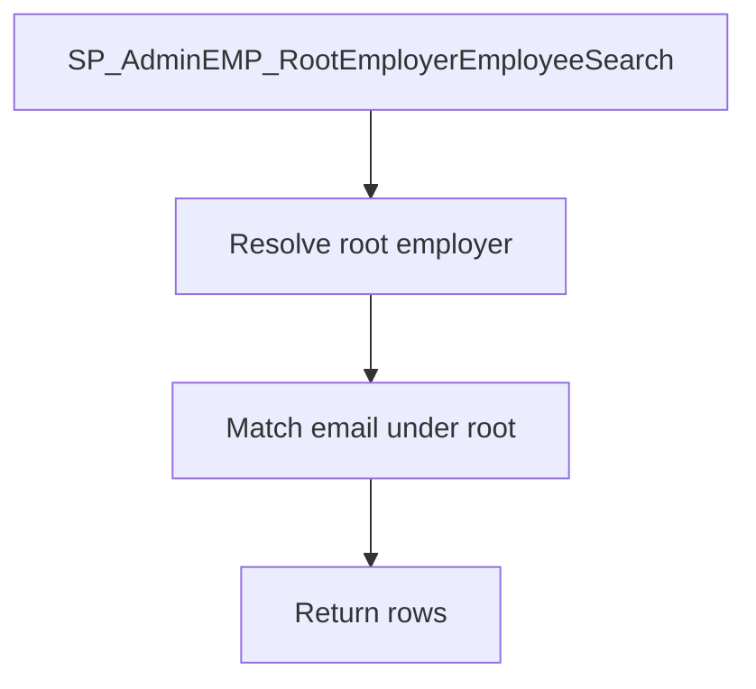

# SP_AdminEMP_RootEmployerEmployeeSearch

## What it does

Looks up employees under a root employer tree that share a given email address. Classic Search Employee uses this when validating copy / root-employer email conflicts.

## Parameters

| Name | Direction | What it is for |
|---|---|---|
| `@EmployerId` | in | Employer whose root tree is searched |
| `@EmailId` | in | Email address to match |

## Call sequence

## Callers

Application caller: classic `SearchEmployee.aspx.cs` via `EmployeeBll.EmployeeSearchRoot` → `EmployeeDal.EmployeeSearchRoot`.

## Nested

None beyond ordinary table reads.

## Steps

1. Script is `HRMS-DATABASE/HRMS/STOREPROCEDURE/SP_AdminEMP_RootEmployerEmployeeSearch.sql`.
2. Resolve the root employer for `@EmployerId`.
3. Return employees in that root scope whose email matches `@EmailId`.

## Tables

| Table | Read or write |
|---|---|
| `dbo.TEmployee` | read |
| `dbo.TEmployerDetails` | read |

## Flow

