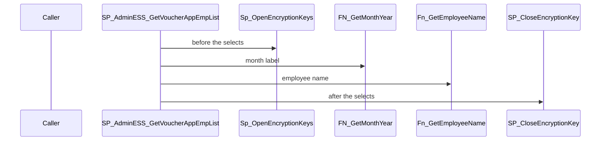
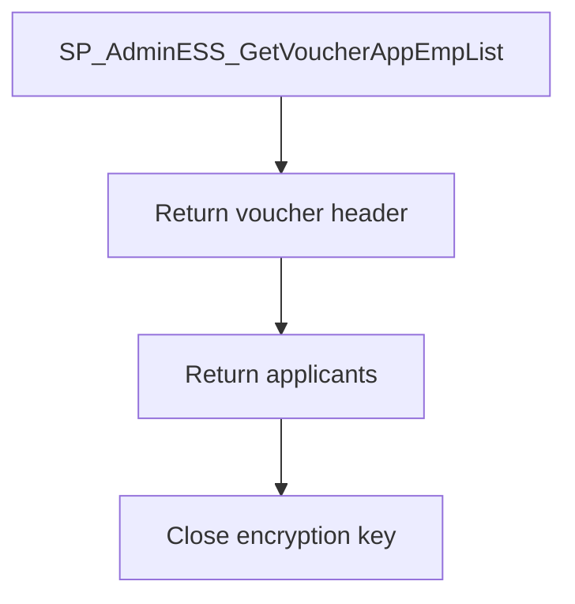

# SP_AdminESS_GetVoucherAppEmpList

## What it does

Returns two result sets for one voucher. The first is the voucher header. The second is employees who applied, excluding requests cancelled by the employee.

## Parameters

| Name | Direction | What it is for |
|---|---|---|
| `@VoucherId` | in | Voucher |

## Call sequence

## Callers

No other procedure or function calls this object.

## Nested

| Object | Kind | When | Page |
|---|---|---|---|
| `Sp_OpenEncryptionKeys` | procedure | before the selects | [Sp_OpenEncryptionKeys](/docs/database/hrms/Sp_OpenEncryptionKeys) |
| `FN_GetMonthYear` | function | month label | [FN_GetMonthYear](/docs/database/hrms/FN_GetMonthYear) |
| `Fn_GetEmployeeName` | function | employee name | [Fn_GetEmployeeName](/docs/database/hrms/Fn_GetEmployeeName) |
| `SP_CloseEncryptionKey` | procedure | after the selects | [SP_CloseEncryptionKey](/docs/database/hrms/SP_CloseEncryptionKey) |

## Steps

1. Open encryption keys (`SP_AdminESS_GetVoucherAppEmpList.sql`).
2. Return type name, voucher name, month label, and note from `TVoucher` and `TvoucherTypeMaster`.
3. Return employment number, name, email, amount, and apply date from `TEmployeeBenefitVoucher` where status is not Cancelled by Employee.
4. Close the encryption key.

## Tables

| Table | Read or write |
|---|---|
| `dbo.TVoucher` | read |
| `dbo.TvoucherTypeMaster` | read |
| `dbo.TEmployee` | read |
| `dbo.TEmployeeInfo` | read |
| `dbo.TEmployeeBenefitVoucher` | read |

## Flow

