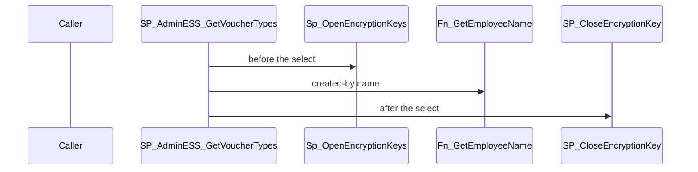
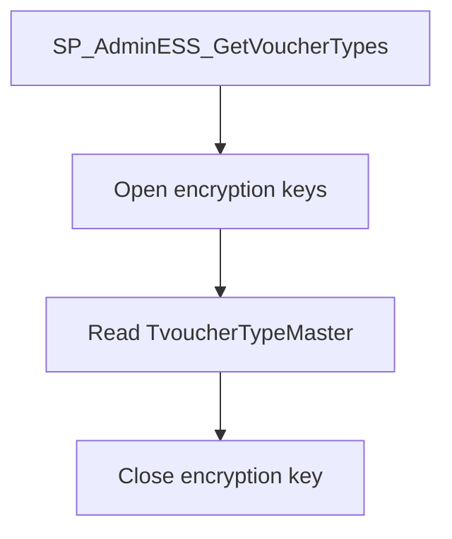

# SP_AdminESS_GetVoucherTypes

## What it does

Returns voucher types for one employer. An optional type id and active flag narrow the list. Created-by is the employee name, and the row includes the stored amount list and the monthly cap.

## Parameters

| Name | Direction | What it is for |
|---|---|---|
| `@EmployerID` | in | Employer whose types are listed |
| `@VoucherTypeID` | in | Optional type id. Null returns every type |
| `@IsActive` | in | Optional Y or N. Null ignores status |

## Call sequence

## Callers

No other procedure or function calls this object.

## Nested

| Object | Kind | When | Page |
|---|---|---|---|
| `Sp_OpenEncryptionKeys` | procedure | before the select | [Sp_OpenEncryptionKeys](/docs/database/hrms/Sp_OpenEncryptionKeys) |
| `Fn_GetEmployeeName` | function | created-by name | [Fn_GetEmployeeName](/docs/database/hrms/Fn_GetEmployeeName) |
| `SP_CloseEncryptionKey` | procedure | after the select | [SP_CloseEncryptionKey](/docs/database/hrms/SP_CloseEncryptionKey) |

## Steps

1. Open encryption keys (`SP_AdminESS_GetVoucherTypes.sql`).
2. Select id, name, created-by name, created date, active flag, amount list, and `MaxAmount` from `TvoucherTypeMaster` for `@EmployerID`.
3. Apply `@IsActive` and `@VoucherTypeID` only when those parameters are not null.
4. Close the encryption key.

## Tables

| Table | Read or write |
|---|---|
| `dbo.TvoucherTypeMaster` | read |

## Flow

