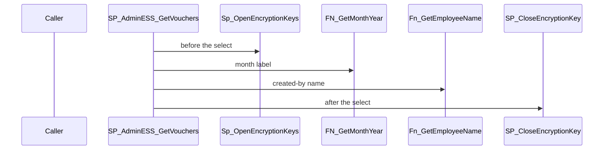
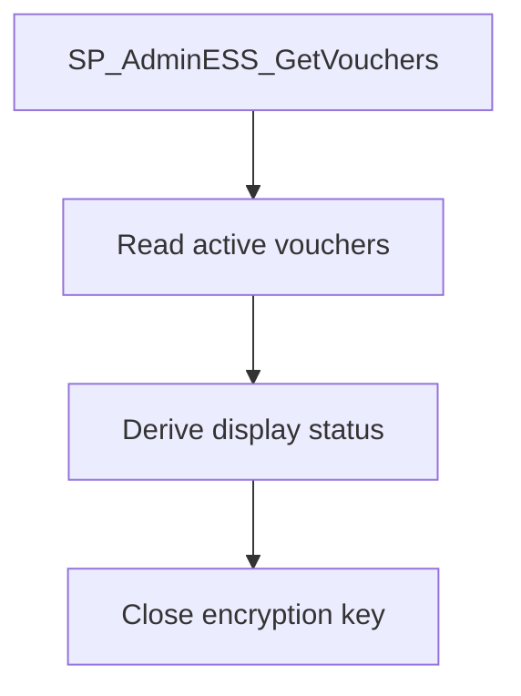

# SP_AdminESS_GetVouchers

## What it does

Returns active vouchers for an employer, with type name, amounts, locations, and a display status. An optional voucher id returns one voucher. Past-due initiation-pending rows are labelled Auto-Cancelled, and past-due initiated rows are labelled Voucher In Process.

## Parameters

| Name | Direction | What it is for |
|---|---|---|
| `@EmployerID` | in | Employer |
| `@VoucherId` | in | Optional voucher id |

## Call sequence

## Callers

No other procedure or function calls this object.

## Nested

| Object | Kind | When | Page |
|---|---|---|---|
| `Sp_OpenEncryptionKeys` | procedure | before the select | [Sp_OpenEncryptionKeys](/docs/database/hrms/Sp_OpenEncryptionKeys) |
| `FN_GetMonthYear` | function | month label | [FN_GetMonthYear](/docs/database/hrms/FN_GetMonthYear) |
| `Fn_GetEmployeeName` | function | created-by name | [Fn_GetEmployeeName](/docs/database/hrms/Fn_GetEmployeeName) |
| `SP_CloseEncryptionKey` | procedure | after the select | [SP_CloseEncryptionKey](/docs/database/hrms/SP_CloseEncryptionKey) |

## Steps

1. Open encryption keys (`SP_AdminESS_GetVouchers.sql`).
2. Join active `TVoucher` rows to `TvoucherTypeMaster` for `@EmployerID`.
3. Build amount and location lists from `TVoucherAmount`, `TVoucherBaseLocations`, and `Tlocation`.
4. Derive the status label from `VoucherStatus` and `ActiveToDate`.
5. Close the encryption key.

## Tables

| Table | Read or write |
|---|---|
| `dbo.TVoucher` | read |
| `dbo.TvoucherTypeMaster` | read |
| `dbo.TVoucherAmount` | read |
| `dbo.TVoucherBaseLocations` | read |
| `dbo.Tlocation` | read |

## Flow

