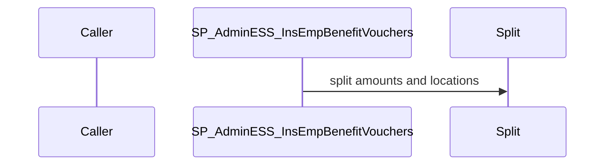
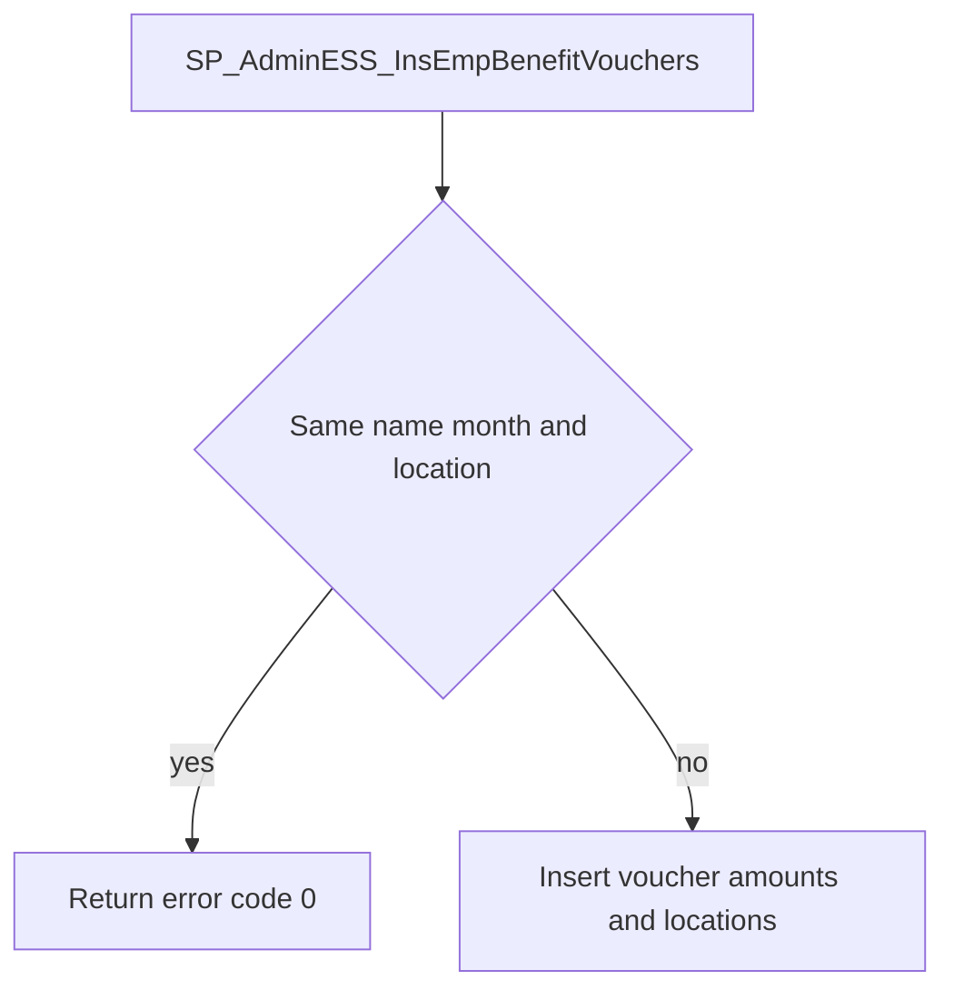

# SP_AdminESS_InsEmpBenefitVouchers

## What it does

Creates a voucher, its amount rows, and its base locations. It refuses the insert when the same type, month, name, and any of the locations already belong to a voucher that is not cancelled and not an expired initiation-pending row.

## Parameters

| Name | Direction | What it is for |
|---|---|---|
| `@VoucherTypeId` | in | Type |
| `@Name` | in | Voucher name |
| `@YearMonth` | in | Year and month key |
| `@ActiveFromDate` | in | Active from |
| `@ActiveToDate` | in | Active to |
| `@ConfirmationMessage` | in | Message shown to employees |
| `@Note` | in | Note |
| `@VoucherStatus` | in | Initial status from the page |
| `@CreatedBy` | in | Creator |
| `@EmployerID` | in | Employer |
| `@VoucherAmount` | in | Comma-separated amounts |
| `@VoucherBaseLocation` | in | Location ids separated by a pipe |

## Call sequence

## Callers

No other procedure or function calls this object.

## Nested

| Object | Kind | When | Page |
|---|---|---|---|
| `Split` | function | split amounts and locations | [Split](/docs/database/hrms/Split) |

## Steps

1. Look for an overlapping voucher on type, month, name, and location (`SP_AdminESS_InsEmpBenefitVouchers.sql`).
2. When one exists, return error code 0 and stop.
3. Insert `TVoucher` as active.
4. Insert one `TVoucherAmount` row per comma-separated amount and one `TVoucherBaseLocations` row per pipe-separated location.
5. Return error code 1.

## Tables

| Table | Read or write |
|---|---|
| `dbo.TVoucher` | read and write |
| `dbo.TVoucherBaseLocations` | read and write |
| `dbo.TVoucherAmount` | write |

## Flow

