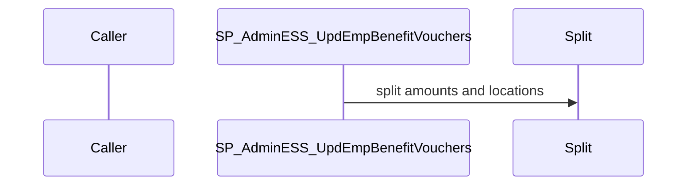
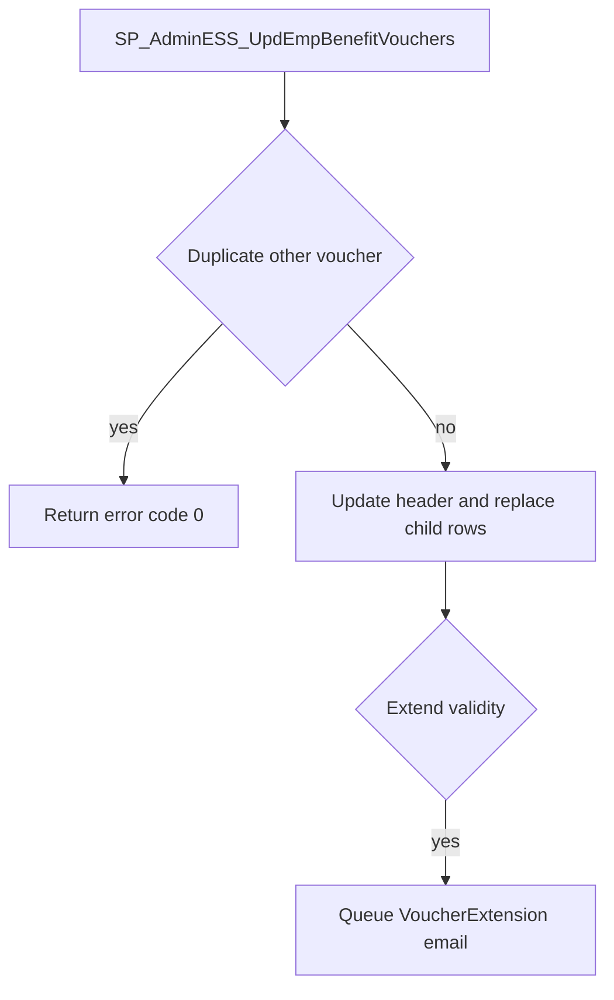

# SP_AdminESS_UpdEmpBenefitVouchers

## What it does

Updates a voucher and replaces its amount and location rows. The same duplicate rule as insert applies to other vouchers. When validity is being extended, it also queues a VoucherExtension email notification.

## Parameters

| Name | Direction | What it is for |
|---|---|---|
| `@VoucherTypeId` | in | Type |
| `@Name` | in | Name |
| `@YearMonth` | in | Year and month |
| `@ActiveFromDate` | in | Active from |
| `@ActiveToDate` | in | Active to |
| `@ConfirmationMessage` | in | Confirmation text |
| `@Note` | in | Note |
| `@UpdatedBy` | in | Editor |
| `@VoucherAmount` | in | Replacement amounts |
| `@VoucherBaseLocation` | in | Replacement locations |
| `@VoucherID` | in | Voucher to update |
| `@IsExtendValidity` | in | 1 queues an extension email |
| `@EmployerId` | in | Employer on the email row |

## Call sequence

## Callers

No other procedure or function calls this object.

## Nested

| Object | Kind | When | Page |
|---|---|---|---|
| `Split` | function | split amounts and locations | [Split](/docs/database/hrms/Split) |

## Steps

1. Refuse the update when another voucher has the same type, month, name, and a shared location (`SP_AdminESS_UpdEmpBenefitVouchers.sql`).
2. Update the voucher header.
3. Delete and reinsert `TVoucherAmount` and `TVoucherBaseLocations`.
4. When `@IsExtendValidity` is 1, insert a pending `TEmailNotification` row named VoucherExtension.
5. Return error code 1.

## Tables

| Table | Read or write |
|---|---|
| `dbo.TVoucher` | read and write |
| `dbo.TVoucherAmount` | write |
| `dbo.TVoucherBaseLocations` | read and write |
| `dbo.TEmailNotification` | write |

## Flow

