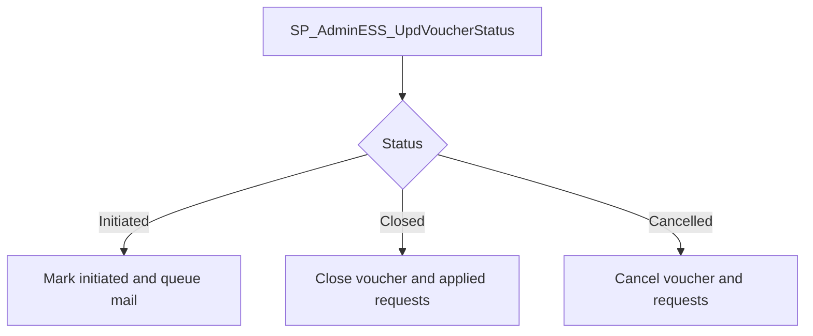

# SP_AdminESS_UpdVoucherStatus

## What it does

Sets a voucher to Initiated, Closed & Amount Credited, or Cancelled, and queues the matching email. Initiate and close also queue a WhatsApp row when the employer has an active WhatsApp client in the messaging database. Close updates applied benefit requests. Cancel updates every benefit request for the voucher.

## Parameters

| Name | Direction | What it is for |
|---|---|---|
| `@VoucherID` | in | Voucher |
| `@VoucherStatus` | in | Initiated, Closed and Amount Credited, or Cancelled |
| `@RequestType` | in | Passed by the page and not used in the script |
| `@EmployerID` | in | Employer on the notification |
| `@UpdatedBy` | in | Employee who changed the status |

## Call sequence

Calls no other procedures or functions.

## Callers

No other procedure or function calls this object.

## Nested

Calls no other procedures or functions.

## Steps

1. For Initiated, set initiated by and date, queue VoucherInitiation email, and queue WhatsApp when `[MSG-MESH].dbo.MessagingClientConfig` has an active WhatsApp row for the employer (`SP_AdminESS_UpdVoucherStatus.sql`).
2. For Closed & Amount Credited, set closed by and date, set applied `TEmployeeBenefitVoucher` rows to that status, and queue VoucherClosure email and optional WhatsApp.
3. For Cancelled, set cancelled by and date, set every benefit request for the voucher to Cancelled, and queue VoucherInitiatedCancellation email.
4. Each branch returns error code 1. Other status values do nothing.

## Tables

| Table | Read or write |
|---|---|
| `dbo.TVoucher` | write |
| `dbo.TEmployeeBenefitVoucher` | write |
| `dbo.TEmployee` | read |
| `dbo.TEmployeeInfo` | read |
| `dbo.TVoucherBaseLocations` | read |
| `dbo.TEmailNotification` | write |
| `dbo.TWhatsAppNotification` | write |
| `MSG-MESH.dbo.MessagingClientConfig` | read |

## Flow

