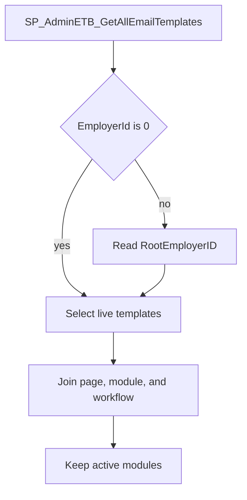

# SP_AdminETB_GetAllEmailTemplates

## What it does

Lists email templates that are not deleted for one employer, with the module page name, module name, workflow name, and a flag when the stored body contains `{{SIGNATURE}}`. Employer `0` keeps modules that are active on `THrmsModules`. Any other employer keeps modules that are active on that employer's root organisation in `TEmployerModule`.

The script begins with `USE [HRM-CL-Prod]`.

## Parameters

| Name | Direction | What it is for |
|---|---|---|
| `@EmployerId` | in | Organisation whose templates are listed. `0` uses the super-admin module filter |

## Call sequence

Calls no other procedures or functions.

## Callers

No other procedure or function calls this object.

The Email Template Builder list calls it from `node_server/routes/templates.js` with `Employerid` 10.

## Nested

Calls no other procedures or functions.

## Steps

1. When `@EmployerId` is not 0, read `RootEmployerID` from `TEmployerDetails` (`SP_AdminETB_GetAllEmailTemplates.sql`).
2. Select non-deleted `TEmailTemplates` rows for that employer.
3. Join `TModulePages` on `ModulePageId = Templatemodule`, `THrmsModules` on `ModuleId = PageModuleId`, and left-join `TWorkflowManagement` on `WorkflowId`.
4. Map template type `A` to Approval, `R` to Rejection, and every other code to Notification. Also return the raw code as `TemplateTypes`.
5. Set `HasSignaturePlaceholder` when `TemplateBodyHTML` contains `{{SIGNATURE}}`.
6. Keep the row when the module is active for employer 0, or when `TEmployerModule` is active for `@RootEmployerID`.

## Tables

| Table | Read or write |
|---|---|
| `TEmployerDetails` | read |
| `TEmailTemplates` | read |
| `TModulePages` | read |
| `THrmsModules` | read |
| `TWorkflowManagement` | read |
| `TEmployerModule` | read |

## Flow

