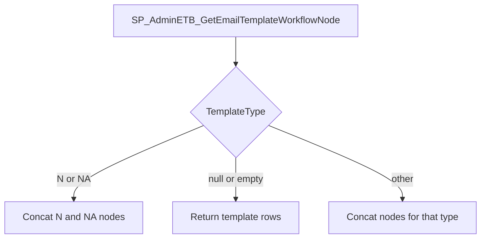

# SP_AdminETB_GetEmailTemplateWorkflowNode

## What it does

Reads `TEmailTemplates.WorkflowNodes` for an employer and template module, optionally filtered by workflow id. Behaviour branches on `@TemplateType`: combined `N`/`NA` node strings, a full template list when type is null/empty, or a single comma-concatenated node string for one type.

## Parameters

| Name | Direction | What it is for |
|---|---|---|
| `@TemplateType` | in | Template type filter. Null/empty returns the full list branch |
| `@EmployerId` | in | Organisation |
| `@TemplateModule` | in | Module / mapped-page module id |
| `@WorkflowId` | in | Optional workflow filter. Default null |

## Call sequence

Calls no other procedures or functions.

## Callers

No other procedure or function calls this object.

Node `WorkflowDAL.GetEmailTemplateWorflowTreeNodes` calls it after Define Workflow tree save when linking email templates.

## Nested

Calls no other procedures or functions.

## Steps

1. When `@TemplateType` is `N` or `NA`, return a concatenated `WorkflowNodes` string from both type `N` and `NA` templates (`SP_AdminETB_GetEmailTemplateWorkflowNode.sql`).
2. When `@TemplateType` is null or empty, return template rows ordered by type length descending.
3. Otherwise return a single concatenated `WorkflowNodes` string for that type.
4. All branches keep `Isdeleted = 0`, match employer and module, and optionally filter by `@WorkflowId`.

## Tables

| Table | Read or write |
|---|---|
| `TEmailTemplates` | read |

## Flow

