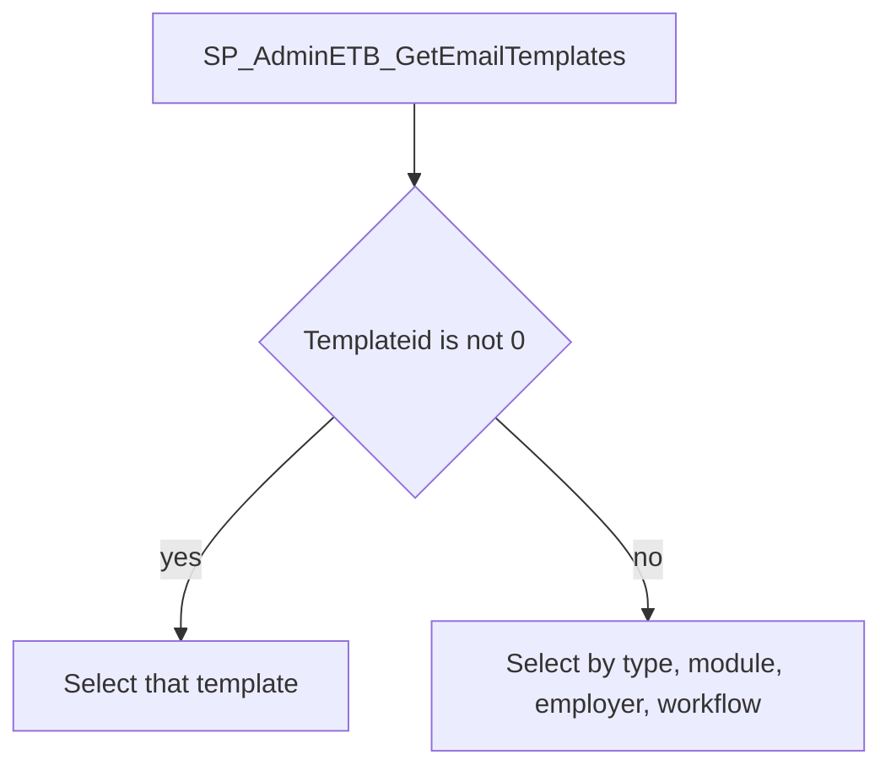

# SP_AdminETB_GetEmailTemplates

## What it does

Returns one non-deleted template when `@Templateid` is not 0, including the stored body and subject HTML and the page's `PageModuleId`. When `@Templateid` is 0, it returns the non-deleted templates for the given type, module, employer, and optional workflow.

## Parameters

| Name | Direction | What it is for |
|---|---|---|
| `@Templateid` | in | Template to load. Default 0 means match by type and module instead |
| `@TEMPLATETYPE` | in | Type code used only when `@Templateid` is 0. Default null |
| `@Employerid` | in | Organisation |
| `@TEMPLATEMODULE` | in | Module page id used only when `@Templateid` is 0. Default null |
| `@WorkflowId` | in | Optional workflow filter on the type-and-module branch |

## Call sequence

Calls no other procedures or functions.

## Callers

No other procedure or function calls this object.

The Email Template Builder editor calls it from `node_server/routes/templates.js` (`getTemplateDetails`).

## Nested

Calls no other procedures or functions.

## Steps

1. When `@Templateid` is not 0, select that row from `TEmailTemplates` for `@Employerid` where `Isdeleted` is 0 (`SP_AdminETB_GetEmailTemplates.sql`).
2. Look up `PageModuleId` from `TModulePages` where `ModulePageId` equals `Templatemodule`.
3. Otherwise select rows for `@TEMPLATETYPE`, `@TEMPLATEMODULE`, and `@Employerid`, still not deleted, and apply `@WorkflowId` only when it is not null.
4. Return `TemplateBodyHTML`, `TemplateSubjectHTML`, `RecipientMap`, and `WorkflowNodes` (empty string when null).

## Tables

| Table | Read or write |
|---|---|
| `TEmailTemplates` | read |
| `TModulePages` | read |

## Flow

