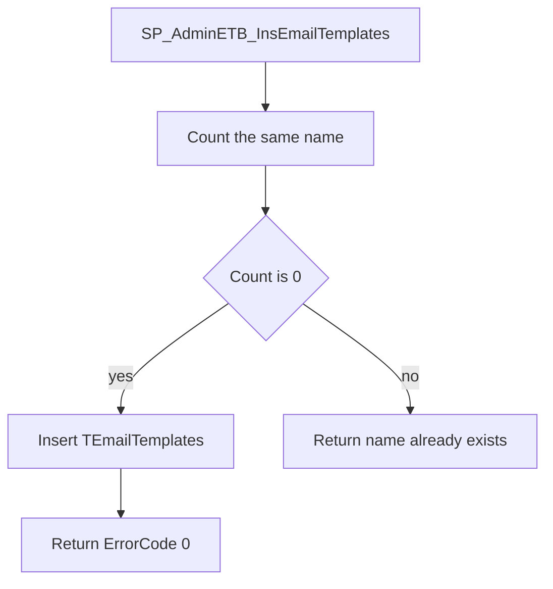

# SP_AdminETB_InsEmailTemplates

## What it does

Inserts one email template when that name is not already used by a non-deleted row for the employer. The path is the `Email Templates` document path plus the employer's `custid` and a backslash. A duplicate name returns an error row and does not insert.

## Parameters

| Name | Direction | What it is for |
|---|---|---|
| `@TemplateName` | in | Name, `varchar(250)`. Also the duplicate key with employer |
| `@TemplateDescription` | in | Description, `varchar(150)` |
| `@Templatemodule` | in | Module page id stored as text, `varchar(100)` |
| `@EmailSubject` | in | Subject, `varchar(100)` |
| `@SubjectFields` | in | Placeholder ids used in the subject |
| `@TemplateType` | in | Type code such as N, NA, A, R, or B |
| `@TemplateFields` | in | Placeholder ids used in the body |
| `@Createdby` | in | User who created the row |
| `@Employerid` | in | Organisation |
| `@IsActive` | in | Active flag, `char` |
| `@WorkflowNodes` | in | Selected workflow-tree nodes |
| `@WorkflowId` | in | Workflow the template belongs to |
| `@TemplateBodyHTML` | in | Body HTML stored on the row |
| `@TemplateSubjectHTML` | in | Subject HTML stored on the row |
| `@RecipientMap` | in | Optional recipient map. Default null |

## Call sequence

Calls no other procedures or functions.

## Callers

No other procedure or function calls this object.

The Email Template Builder save route calls it from `node_server/routes/templates.js` when `templateId` is empty. `EmailDAL.SaveEmailTemplateDetails` calls the same procedure name from the older HTML editor.

## Nested

Calls no other procedures or functions.

## Steps

1. Count non-deleted `TEmailTemplates` rows with the same `@TemplateName` and `@Employerid` (`SP_AdminETB_InsEmailTemplates.sql`).
2. When the count is 0, insert the row. `Isdeleted` is 0 and `Createdate` is `GETDATE()`.
3. Set `TemplatePath` to `DocumentPath` from `TDocumentPaths` where `DocumentType` is `Email Templates`, plus `custid` from `TEmployerDetails` for `@Employerid`, plus `\`.
4. Return `ErrorCode` 0 and `Template Created Successfully`.
5. When the count is not 0, return `ErrorCode` 1 and `Template Name already exist.`

## Tables

| Table | Read or write |
|---|---|
| `TEmailTemplates` | read, then write |
| `TDocumentPaths` | read |
| `TEmployerDetails` | read |

## Flow

