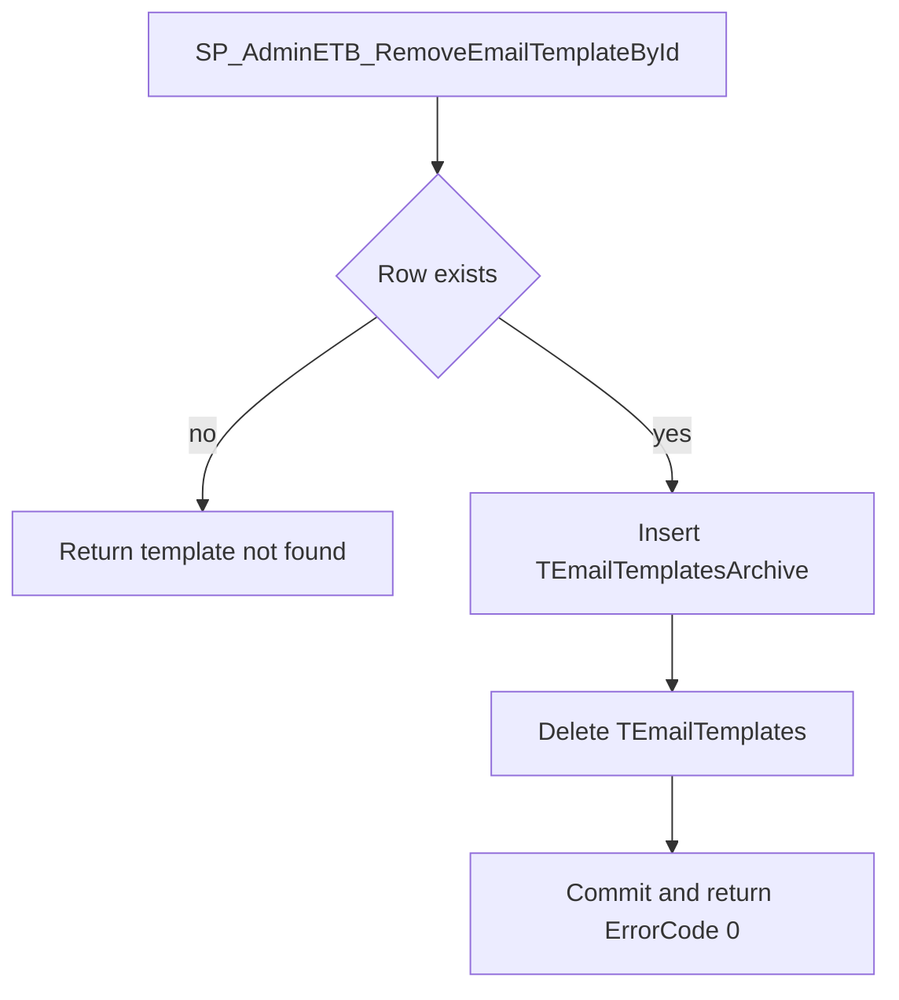

# SP_AdminETB_RemoveEmailTemplateById

## What it does

Archives one template into `TEmailTemplatesArchive` and then deletes it from `TEmailTemplates`. A missing id returns an error and does not open the transaction. A failure inside the transaction rolls it back and returns `ERROR_MESSAGE()`.

## Parameters

| Name | Direction | What it is for |
|---|---|---|
| `@Templateid` | in | Template to archive and delete |
| `@DeletedBy` | in | Optional user stored on the archive row. Default null |

## Call sequence

Calls no other procedures or functions.

## Callers

No other procedure or function calls this object.

The Email Template Builder delete route calls it from `node_server/routes/templates.js`, once per id, and does not pass `@DeletedBy`.

## Nested

Calls no other procedures or functions.

## Steps

1. Count `TEmailTemplates` rows for `@Templateid` (`SP_AdminETB_RemoveEmailTemplateById.sql`).
2. When the count is 0, return `ErrorCode` 1 and `Template not found.` and return.
3. Begin a transaction.
4. Insert the current row into `TEmailTemplatesArchive` with `@DeletedBy` and `Deletedate` = `GETDATE()`.
5. Delete the row from `TEmailTemplates`.
6. Commit and return `ErrorCode` 0 and `Template deleted and archived successfully`.
7. On error, roll back and return `ErrorCode` 1 with `ERROR_MESSAGE()`.

## Tables

| Table | Read or write |
|---|---|
| `TEmailTemplates` | read, then delete |
| `TEmailTemplatesArchive` | write |

## Flow

