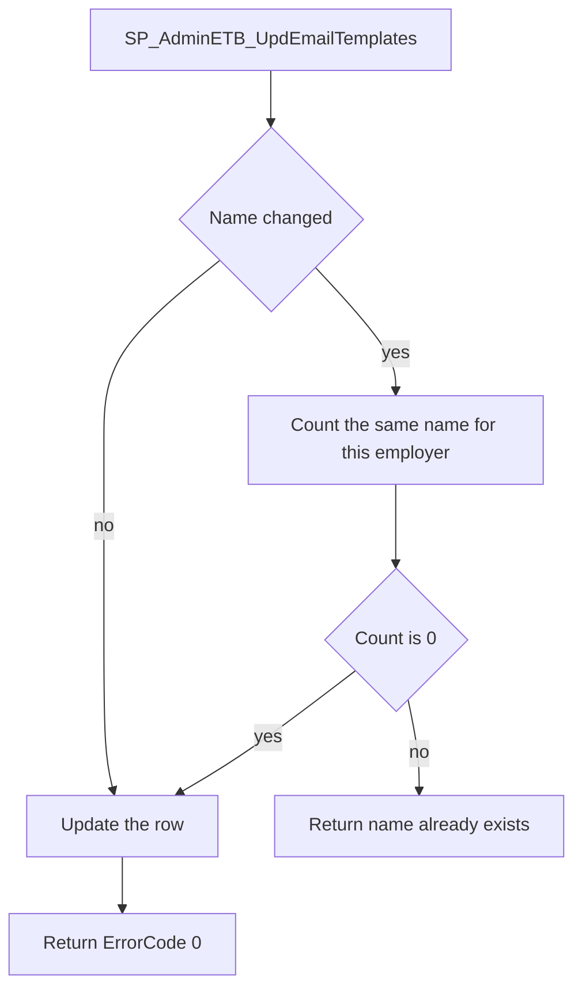

# SP_AdminETB_UpdEmailTemplates

## What it does

Updates one template by id. If the name changed, it rejects the update when another non-deleted template for the same employer already uses that name. Otherwise it writes the new subject, body, path, workflow, and recipient map and stamps `Updatedate`.

## Parameters

| Name | Direction | What it is for |
|---|---|---|
| `@Templateid` | in | Row to update |
| `@TemplateName` | in | New name |
| `@TemplateDescription` | in | Description |
| `@Templatemodule` | in | Module page id as text |
| `@EmailSubject` | in | Subject |
| `@TemplateType` | in | Type code |
| `@TemplatePath` | in | Path stored on the row |
| `@TemplateFields` | in | Body placeholder ids |
| `@SubjectFields` | in | Subject placeholder ids |
| `@Isdeleted` | in | Deleted flag written onto the row |
| `@Updateby` | in | User who updated the row |
| `@IsActive` | in | Active flag |
| `@WorkflowNodes` | in | Selected workflow-tree nodes |
| `@WorkflowId` | in | Workflow |
| `@TemplateBodyHTML` | in | Body HTML |
| `@TemplateSubjectHTML` | in | Subject HTML |
| `@RecipientMap` | in | Optional recipient map. Default null |

## Call sequence

Calls no other procedures or functions.

## Callers

No other procedure or function calls this object.

The Email Template Builder save route calls it from `node_server/routes/templates.js` when `templateId` is set. `EmailDAL.UpdateEmailTemplateDetails` calls the same procedure name from the older HTML editor.

## Nested

Calls no other procedures or functions.

## Steps

1. Read the current `TemplateName` for `@Templateid` (`SP_AdminETB_UpdEmailTemplates.sql`).
2. When the new name differs, count other non-deleted rows with that name and the same employer as this template.
3. When that count is 0, update the row and set `Updatedate` to `GETDATE()`.
4. Return `ErrorCode` 0 and `Template Updated Successfully`.
5. When the count is not 0, return `ErrorCode` 1 and `Template Name already exist.`

## Tables

| Table | Read or write |
|---|---|
| `TEmailTemplates` | read, then write |

## Flow

