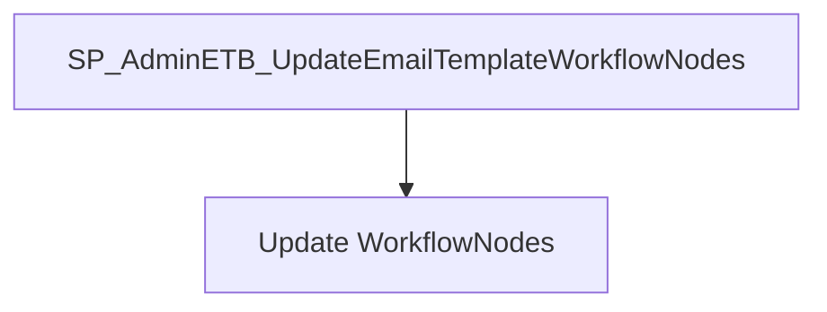

# SP_AdminETB_UpdateEmailTemplateWorkflowNodes

## What it does

Updates `TEmailTemplates.WorkflowNodes` for one template id. Define Workflow save uses it after rebuilding the approval tree so email templates keep matching node paths.

## Parameters

| Name | Direction | What it is for |
|---|---|---|
| `@TemplateId` | in | Email template to update |
| `@WorkflowNodes` | in | New node path string |

## Call sequence

Calls no other procedures or functions.

## Callers

No other procedure or function calls this object.

Node `WorkflowDAL.UpdateWorkflowNodesForEmailTemplate` calls it from the tree-save email linkage path.

## Nested

Calls no other procedures or functions.

## Steps

1. `UPDATE TEmailTemplates SET WorkflowNodes = @WorkflowNodes WHERE Templateid = @TemplateId` (`SP_AdminETB_UpdateEmailTemplateWorkflowNodes.sql`).

## Tables

| Table | Read or write |
|---|---|
| `TEmailTemplates` | write |

## Flow

