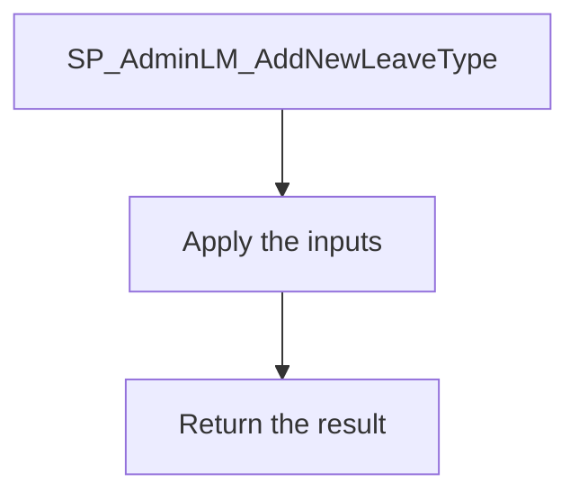

# SP_AdminLM_AddNewLeaveType

## What it does

Legacy WebForms insert for Create Leave Type. Files admin approval when a workflow is mapped; otherwise inserts leave-type master rows and related allot/avail and policy data.

## Parameters

No parameters were parsed from the script signature.

## Call sequence

Calls no other procedures or functions.

## Callers

| Object | Kind | Page |
|---|---|---|
| `uspTLeaveManagementMaster` | procedure | No page yet |
| `uspTLeaveManagementMaster_New` | procedure | No page yet |

## Nested

Calls no other procedures or functions.

## Steps

In `HRMS-DATABASE/HRMS/STOREPROCEDURE/SP_AdminLM_AddNewLeaveType.sql`:
1. Accept the declared parameters and run the procedure or function body.
4. Return result sets, scalar values, or status as defined in the script.

## Tables

No `T*` tables were matched in a simple FROM/JOIN/INSERT/UPDATE/DELETE scan.

## Flow

