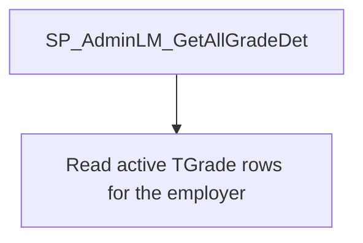

# SP_AdminLM_GetAllGradeDet

## What it does

Returns the active grades for one employer. Policy Documents Setup binds `GradeId` and `GradeName` to the grade exclusion list. The script has no header comment.

`LeaveManagementDAL.GetAllGrades` calls this.

## Parameters

| Name | Direction | What it is for |
|---|---|---|
| `@Employerid` | in | Employer whose grades are listed. |

## Call sequence

Calls no other procedures or functions.

## Callers

No other procedure or function calls this object. `LeaveManagementDAL.GetAllGrades` executes it. Policy Documents Setup uses the list for the grade exclusion.

## Nested

Calls no other procedures or functions.

## Steps

1. In `HRMS-DATABASE/HRMS/STOREPROCEDURE/SP_AdminLM_GetAllGradeDet.sql`, select `GradeId`, `GradeName`, `GradeDesc`, `GradeBand`, and `IsActive` from `TGrade`.
2. Keep rows where `IsActive` is 1 and `Employerid` is `@Employerid`.
3. There is no `ORDER BY`.

`TGrade` declares a primary key on `GradeId` and no foreign key. The insert and update procedures compare the selected ids with `TEmployeeInfo.Grade`, which has no foreign key to `TGrade`.

## Tables

| Table | Read or write |
|---|---|
| `dbo.TGrade` | read |

## Flow

