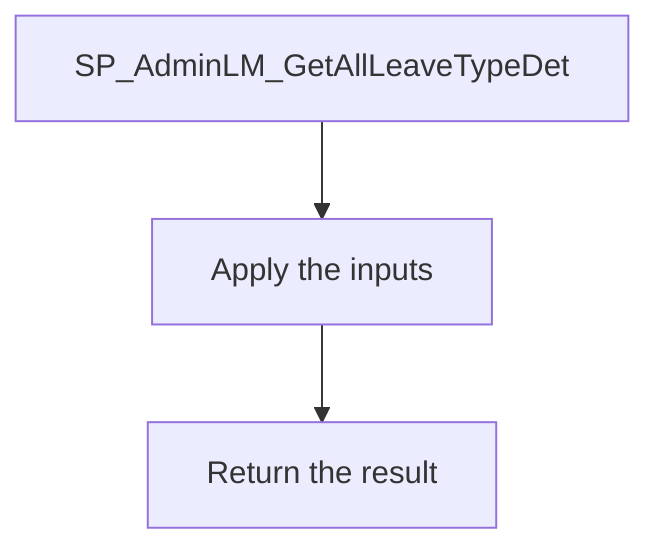

# SP_AdminLM_GetAllLeaveTypeDet

## What it does

Returns leave-type master rows for an employer for the WebForms Create Leave Type grid. Optionally excludes event-triggered types.

## Parameters

No parameters were parsed from the script signature.

## Call sequence

Calls no other procedures or functions.

## Callers

No other procedure or function calls this object.

## Nested

Calls no other procedures or functions.

## Steps

In `HRMS-DATABASE/HRMS/STOREPROCEDURE/SP_AdminLM_GetAllLeaveTypeDet.sql`:
1. Accept the declared parameters and run the procedure or function body.
4. Return result sets, scalar values, or status as defined in the script.

## Tables

No `T*` tables were matched in a simple FROM/JOIN/INSERT/UPDATE/DELETE scan.

## Flow

