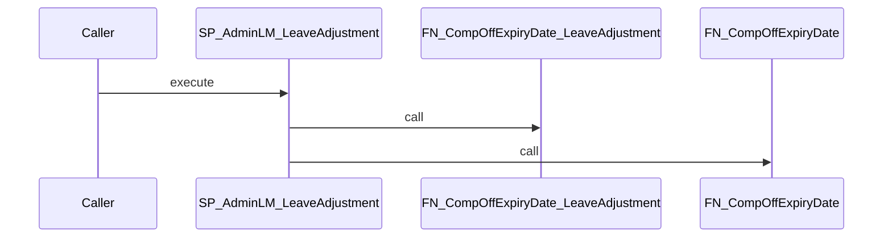
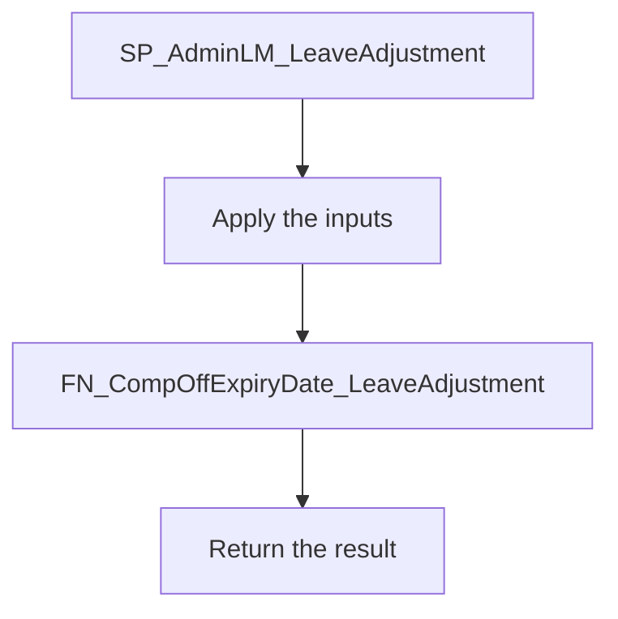

# SP_AdminLM_LeaveAdjustment

## What it does

Credits or debits an employee leave balance and writes ledger rows; used by WebForms adjustment and by React LBA save.

## Parameters

| Name | Direction | What it is for |
|---|---|---|
| `@LeaveType` | in | `CHAR(4)` |
| `@IsBulkAdjustment` | in | `BIT` |
| `@IsCredit` | in | `BIT` |
| `@LeaveDetails` | in | `VARCHAR(4000)` |
| `@NofOfDays` | in | null |
| `@Reason` | in | `VARCHAR(500)` |
| `@ModifiedBy` | in | `INT` |
| `@Employerid` | in | `INT` |
| `@WorkDate` | in | `DATE` |
| `@NoofDaysToExpire` | in | `INT` |
| `@CompOffExpiryDay` | in | `INT` |
| `@CompOffExpiryMonth` | in | `INT` |
| `@InputFrom` | in | `VARCHAR(100)` |
| `@IsOpeningBalance` | in | `BIT` |

## Call sequence

## Callers

| Object | Kind | Page |
|---|---|---|
| `USP_COB_ProcessTLeaveBalance` | procedure | No page yet |

## Nested

| Object | Kind | When | Page |
|---|---|---|---|
| `FN_CompOffExpiryDate_LeaveAdjustment` | function | Called while this object runs | [FN_CompOffExpiryDate_LeaveAdjustment](/docs/database/hrms/FN_CompOffExpiryDate_LeaveAdjustment) |
| `FN_CompOffExpiryDate` | function | Called while this object runs | [FN_CompOffExpiryDate](/docs/database/hrms/FN_CompOffExpiryDate) |

## Steps

In `HRMS-DATABASE/HRMS/STOREPROCEDURE/SP_AdminLM_LeaveAdjustment.sql`:
1. Accept the declared parameters and run the procedure or function body.
2. Call nested objects listed under Nested when their guarding branches are true.
3. Read or write the tables listed under Tables.
4. Return result sets, scalar values, or status as defined in the script.

## Tables

| Table | Read or write |
|---|---|
| `TComp_OffRequestByEmployee` | read or write |
| `TComp_OffRequestByEmployee_History` | read or write |
| `TCompOffRequest_LeaveDetails` | read or write |
| `tLeaveAdjustments` | read or write |
| `tLeaveBalance` | read or write |
| `TLeaveBalance` | read or write |
| `TLeaveBalanceLedger` | read or write |
| `TLeaveTypeMaster` | read or write |

## Flow

