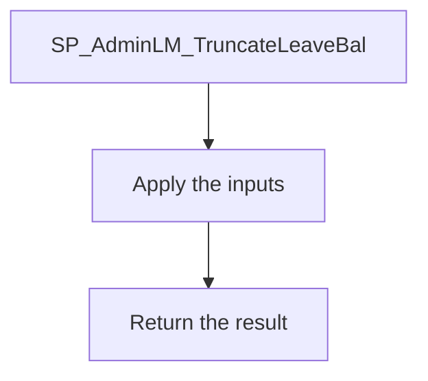

# SP_AdminLM_TruncateLeaveBal

## What it does

For leave types with truncation enabled, caps employee balances at carry-forward limit and writes truncation ledger rows.

## Parameters

No parameters were parsed from the script signature.

## Call sequence

Calls no other procedures or functions.

## Callers

No other procedure or function calls this object.

## Nested

Calls no other procedures or functions.

## Steps

In `HRMS-DATABASE/HRMS/STOREPROCEDURE/SP_AdminLM_TruncateLeaveBal.sql`:
1. Accept the declared parameters and run the procedure or function body.
4. Return result sets, scalar values, or status as defined in the script.

## Tables

No `T*` tables were matched in a simple FROM/JOIN/INSERT/UPDATE/DELETE scan.

## Flow

