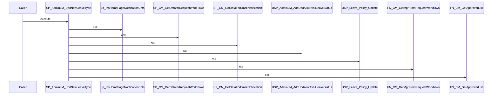
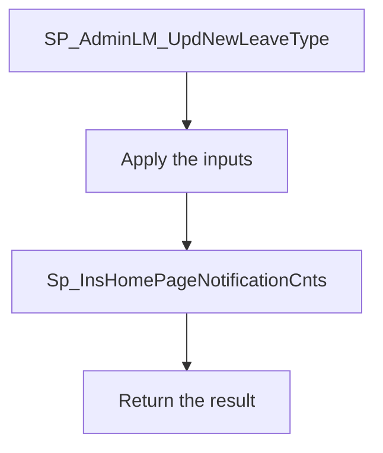

# SP_AdminLM_UpdNewLeaveType

## What it does

Legacy WebForms update for Create Leave Type. Same approval fork as insert; may notify approvers and update allot/avail and policy rows.

## Parameters

| Name | Direction | What it is for |
|---|---|---|
| `@LeaveCode` | in | `VARCHAR(4)` |
| `@StartPeriod` | in | `DATETIME` |
| `@Gender` | in | `CHAR(1)` |
| `@AllowCancellation` | in | `Bit` |
| `@AllowPullback` | in | `Bit` |
| `@PullbackApplicable` | in | `BIT` |
| `@AllowHalfDays` | in | `BIT` |
| `@AllowPastDays` | in | `BIT` |
| `@InterveningHolidays` | in | `BIT` |
| `@InterveningWeeklyOff` | in | `BIT` |
| `@MaxDaysToApply` | in | null |
| `@MinDaysToApply` | in | null |
| `@WaitingPeriod` | in | `INT` |
| `@MaximumApplications` | in | `INT` |
| `@MaximumApplicationPeriod` | in | `VARCHAR(50)` |
| `@AllowDaysPerMonth` | in | null |
| `@IsActive` | in | `BIT` |
| `@PrefixWeeklyOff` | in | `BIT` |
| `@SuffixWeeklyOff` | in | `BIT` |
| `@PrefixHoliday` | in | `BIT` |
| `@SuffixHoliday` | in | `BIT` |
| `@CreaditOnStatusChange` | in | `BIT` |
| `@LossOfPay` | in | `BIT` |
| `@RecoverLeaveBalance` | in | `BIT` |
| `@Encashable` | in | `BIT` |
| `@EncashmentFrequency` | in | `VARCHAR` |
| `@EncashmentLimit` | in | null |
| `@MinimumBalanceForEncasshment` | in | null |
| `@ReInitialiseBalanceEveryYear` | in | `BIT` |
| `@ReInitializationMonth` | in | `VARCHAR(15)` |
| `@CurrentYearNegativeBalanceAllowed` | in | `BIT` |
| `@LeaveTruncation` | in | `BIT` |
| `@CarryForwardDaysLimit` | in | null |
| `@TruncationMonth` | in | `VARCHAR(15)` |
| `@BusinessUnit` | in | `VARCHAR(MAX)` |
| `@Location` | in | `VARCHAR` |
| `@Grade` | in | `VARCHAR` |
| `@Calendar` | in | `VARCHAR(MAX)` |
| `@AllotLeaveEmployeeStatus` | in | `VARCHAR(MAX)` |
| `@AvailLeaveEmployeeStatus` | in | `VARCHAR(MAX)` |
| `@ClubWith` | in | `VARCHAR` |
| `@UpdatedBy` | in | `INT` |
| `@Employerid` | in | `INT` |
| `@IsLeaveTypeCompOff` | in | `CHAR(1)` |
| `@RequestCompOffCredit` | in | `VARCHAR(100)` |
| `@AttendanceBasedOn` | in | `VARCHAR(300)` |
| `@HalfDayRule` | in | `TIME(7)` |
| `@FullDayRule` | in | `TIME(7)` |
| `@ColorCode` | in | `VARCHAR(300)` |
| `@ValidateCompOff` | in | `BIT` |
| `@Pastdatepullback` | in | `CHAR(1)` |
| `@Futuredatepullback` | in | `CHAR(1)` |
| `@PastPullbackNoDays` | in | `INT` |
| `@FuturePullbackNoDays` | in | `INT` |
| `@PastPullbackApplicableType` | in | `CHAR(1)` |
| `@FuturePullbackApplicableType` | in | `CHAR(1)` |
| `@CompOffExpiryType` | in | `VARCHAR(50)` |
| `@CompOffExpiryNoDays` | in | `INT` |
| `@CompOffExpiryDay` | in | `INT` |
| `@CompOffExpiryMonth` | in | `INT` |
| `@NumberOfDaysAutoApproval` | in | `INT` |
| `@EnableForAutoApproval` | in | `VARCHAR(30)` |
| `@CommentsAutoApproval` | in | `VARCHAR(100)` |
| `@IsEnableAutoApproval` | in | `BIT` |
| `@MaritalStatusIds` | in | `VARCHAR(100)` |
| `@CurrentYearNegativeBalanceLimit` | in | `NUMERIC(9` |
| `@IsDateValidationRequired` | in | `BIT` |
| `@IsDateValidationBasedOnDOB` | in | `BIT` |
| `@IsDateValidationBasedOnWeddingDate` | in | `BIT` |
| `@IsLeaveRequestAllowedOnDiffDates` | in | `BIT` |
| `@IsApplyLeavesInNoticePeriod` | in | `BIT` |
| `@MaxLimitBasedOn` | in | `VARCHAR(100)--AvailableLeaveBalance` |
| `@MaxLimitDaysInNP` | in | `NUMERIC(9` |
| `@MaxLimitInDays` | in | `INT` |
| `@MinLeaveAvailOption` | in | `VARCHAR(100)` |
| `@MaxLeaveAvailOption` | in | `VARCHAR(100)--` |
| `@IsSetMaxAppPerEmploymentTenure` | in | `BIT` |
| `@InterveningHolidayOptions` | in | `VARCHAR(20)` |
| `@InterveningWeeklyOffOptions` | in | `VARCHAR(20)` |
| `@IsSelectiveHalfDay` | in | `BIT` |
| `@FirstHalf` | in | `BIT` |
| `@SecondHalf` | in | `BIT` |
| `@IsMinAttendanceRequired` | in | `BIT` |
| `@MinAttendanceDuration` | in | `TIME` |
| `@IsAutoCalculateToDate` | in | `BIT` |
| `@LeaveType` | in | `VARCHAR(100)` |
| `@AlwLeaveReqinMultipleofMin` | in | `BIT` |
| `@MaximumHoursPerDay` | in | `NUMERIC(9` |
| `@MaximumHoursPerWeek` | in | `NUMERIC(9` |
| `@MaximumHoursPerMonth` | in | `NUMERIC(9` |
| `@MaximumHoursPerQuarter` | in | `NUMERIC(9` |
| `@MaximumHoursPerHalfYear` | in | `NUMERIC(9` |
| `@MaximumHoursPerYear` | in | `NUMERIC(9` |
| `@IsDisplayOnSalarySlip` | in | `BIT` |
| `@DisplayOnSalarySlipOptions` | in | `VARCHAR(100)` |
| `@IsLeaveLapseNCarryFwdApp` | in | `BIT` |
| `@LeaveCalendar` | in | `VARCHAR(200)` |
| `@LapseFrequency` | in | `VARCHAR(200)` |
| `@LapseFreqFromDay` | in | `INT` |
| `@LapseFreqFromMonth` | in | `INT` |

The signature continues with 35 more parameters in the script.

## Call sequence

## Callers

No other procedure or function calls this object.

## Nested

| Object | Kind | When | Page |
|---|---|---|---|
| `Sp_InsHomePageNotificationCnts` | procedure | Called while this object runs | [Sp_InsHomePageNotificationCnts](/docs/database/hrms/Sp_InsHomePageNotificationCnts) |
| `SP_CM_GetDataforRequestWorkFlows` | procedure | Called while this object runs | [SP_CM_GetDataforRequestWorkFlows](/docs/database/hrms/SP_CM_GetDataforRequestWorkFlows) |
| `SP_CM_GetDataForEmailNotification` | procedure | Called while this object runs | [SP_CM_GetDataForEmailNotification](/docs/database/hrms/SP_CM_GetDataForEmailNotification) |
| `USP_AdminLM_AddUpdAllotAvailLeaveStatus` | procedure | Called while this object runs | [USP_AdminLM_AddUpdAllotAvailLeaveStatus](/docs/database/hrms/USP_AdminLM_AddUpdAllotAvailLeaveStatus) |
| `USP_Leave_Policy_Update` | procedure | Called while this object runs | [USP_Leave_Policy_Update](/docs/database/hrms/USP_Leave_Policy_Update) |
| `FN_CM_GetMgrFromRequestWorkflows` | function | Called while this object runs | [FN_CM_GetMgrFromRequestWorkflows](/docs/database/hrms/FN_CM_GetMgrFromRequestWorkflows) |
| `FN_CM_GetApproverList` | function | Called while this object runs | [FN_CM_GetApproverList](/docs/database/hrms/FN_CM_GetApproverList) |

## Steps

In `HRMS-DATABASE/HRMS/STOREPROCEDURE/SP_AdminLM_UpdNewLeaveType.sql`:
1. Accept the declared parameters and run the procedure or function body.
2. Call nested objects listed under Nested when their guarding branches are true.
3. Read or write the tables listed under Tables.
4. Return result sets, scalar values, or status as defined in the script.

## Tables

| Table | Read or write |
|---|---|
| `TAdminChangesApprovalDetails` | read or write |
| `TAdminChangesApprovals` | read or write |
| `TEmailNotification` | read or write |
| `TEmployee` | read or write |
| `TEmployeeInfo` | read or write |
| `tLeaveBalance` | read or write |
| `TLeaveBalanceLedger` | read or write |
| `TLeaveBusinessUnit` | read or write |
| `TLeaveBusinessUnit_History` | read or write |
| `TLeaveCalendar` | read or write |
| `TLeaveCalendar_History` | read or write |
| `TLeaveClubWith` | read or write |
| `TLeaveClubWith_History` | read or write |
| `TLeaveEmployeeStatus` | read or write |
| `tLeaveEventDetails` | read or write |
| `tLeaveEventDetails_History` | read or write |
| `TLeaveGrade` | read or write |
| `TLeaveGrade_History` | read or write |
| `TLeaveLocation` | read or write |
| `TLeaveLocation_History` | read or write |
| `TLeavePolicy` | read or write |
| `TLeaveRequest` | read or write |
| `TLeaveRequestDays` | read or write |
| `tLeaveTypeMaster` | read or write |
| `TLeaveTypeMaster` | read or write |
| `TLeaveTypeMaster_History` | read or write |
| `TModulePages` | read or write |
| `TRequestWorkflows` | read or write |
| `TWorkflowManagement` | read or write |

## Unresolved calls

- `sp_executesql` (dynamic SQL)

## Flow

