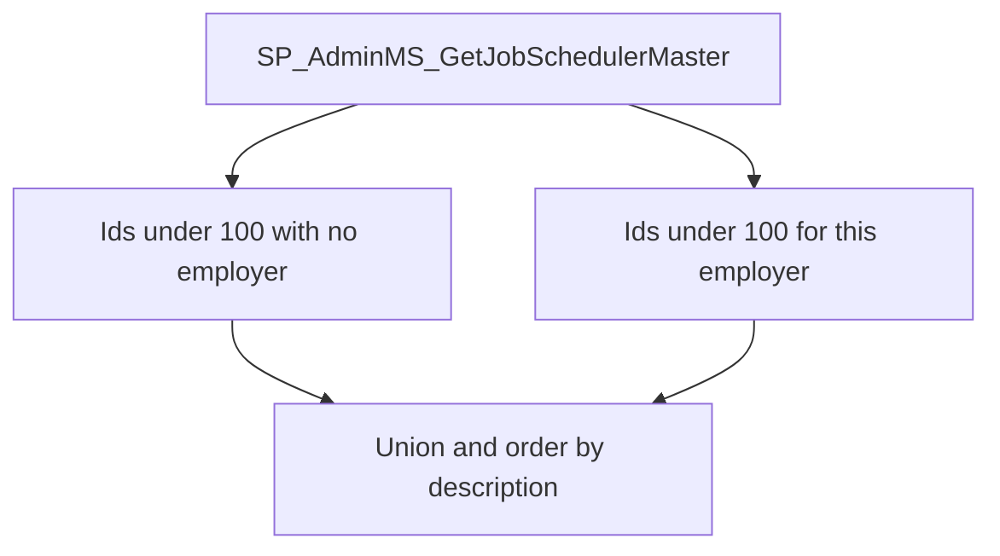

# SP_AdminMS_GetJobSchedulerMaster

## What it does

Returns the job dropdown on Schedule\Run Scheduler. It lists master rows whose `SchedulerId` is under 100, combining the shared catalogue (`EmployerId` is null) with rows for the selected employer. The constant `SP_GetJobSchedulerMaster` in `DBConstant.cs` is this procedure name.

## Parameters

| Name | Direction | What it is for |
|---|---|---|
| `@EmployerId` | in | Organisation added in the second branch of the union |

## Call sequence

Calls no other procedures or functions.

## Callers

Procedures and functions that call this object.

No other procedure or function calls this object.

## Nested

Calls no other procedures or functions.

## Steps

1. In `HRMS-DATABASE/HRMS/STOREPROCEDURE/SP_AdminMS_GetJobSchedulerMaster.sql`, select `SchedulerId`, `SchedulerName`, and `SchedulerDescription` from `TJobSchedulerMaster` where `SchedulerId` is less than 100 and `EmployerId` is null.

2. Union the same columns where `SchedulerId` is less than 100 and `EmployerId` equals `@EmployerId`.

3. Order by `SchedulerDescription`.

## Tables

| Table | Read or write |
|---|---|
| `TJobSchedulerMaster` | read |

## Flow

