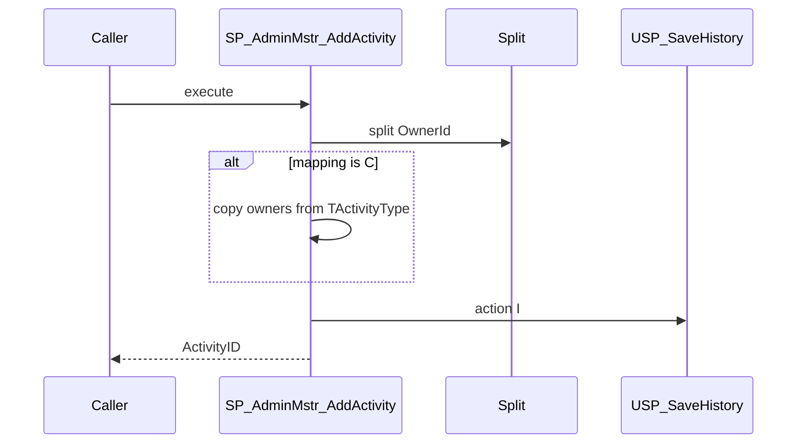
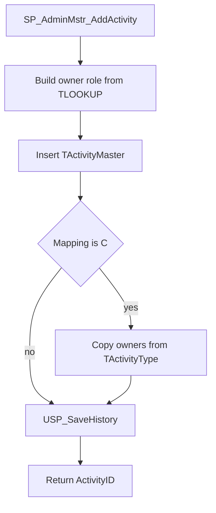

# SP_AdminMstr_AddActivity

## What it does

Inserts one clearance activity into `TActivityMaster` and returns the new `ActivityID`. Owner role text is built from `TLOOKUP` through `dbo.Split`. When `@ClearanceApproverMapping` is `C`, the new row's owner columns are overwritten from the matching `TActivityType`. `USP_SaveHistory` is then called for the new activity.

## Parameters

| Name | Direction | What it is for |
|---|---|---|
| `@activityName` | in | Activity name |
| `@activityDesc` | in | Description |
| `@activityOwner` | in | Owner display text |
| `@ActivityOwnerId` | in | Owner id text |
| `@activitySecondaryOwner` | in | Secondary owner role id |
| `@activityType` | in | `TActivityType.ActivityTypeID` |
| `@CreatedBy` | in | Employee who added the activity |
| `@Employerid` | in | Organisation |
| `@OwnerId` | in | Comma-separated lookup ids for `OwnerType` |
| `@IsMandatory` | in | Mandatory flag |
| `@RecoveryApplicable` | in | Recovery flag |
| `@ShowAssetDetailsinClearanceApproval` | in | Show asset details on approval |
| `@ActivityResponseType` | in | Response type. Optional |
| `@NoOfChoices` | in | Number of choices |
| `@ActivityResponseValues` | in | Choice values |
| `@IsActive` | in | Active flag |
| `@IsOnHoldApplicable` | in | On-hold flag |
| `@ClearanceApproverMapping` | in | `C` copies owners from the category |

## Call sequence

## Callers

No other procedure or function calls this object.

## Nested

| Object | Kind | When | Page |
|---|---|---|---|
| `Split` | function | while building `OwnerType` | [Split](/docs/database/hrms/Split) |
| `USP_SaveHistory` | procedure | after the insert | No page yet |

`USP_SaveHistory` is executed by name. Its script is not in `HRMS-DATABASE`.

## Steps

1. Build `@OwnerRole` by splitting `@OwnerId` and reading `TLOOKUP.AdditionalInfo` for those lookup ids and the employer.

2. Insert `TActivityMaster` with the name, description, owners, activity type, employer, mandatory and recovery flags, response settings, and active flags. `OwnerType` is the trimmed role string. The new id is `@@IDENTITY`.

3. When `@ClearanceApproverMapping` is `C`, set the new row's `ActivityOwner`, `ActivityOwnerid`, and `OwnerType` from `TActivityType` joined on `ActivityTypeID`.

4. Execute `USP_SaveHistory` for `TActivityMaster` / `TActivityMaster_History` with action `I`, then select the new activity id.

## Tables

| Table | Read or write |
|---|---|
| `TLOOKUP` | read |
| `TActivityMaster` | write |
| `TActivityType` | read when mapping is `C` |

## Flow

