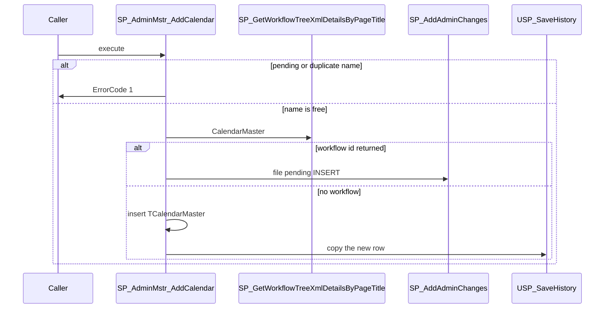
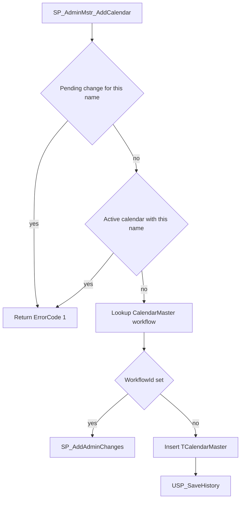

# SP_AdminMstr_AddCalendar

## What it does

Adds one calendar for an employer, or holds that insert for admin approval. It rejects the request when a pending admin change already uses the same calendar name, and when an active calendar with that name already exists. It then loads the workflow for module page `CalendarMaster`. When that workflow exists, it files a pending insert. When it does not, it inserts `TCalendarMaster` and calls `USP_SaveHistory`.

## Parameters

| Name | Direction | What it is for |
|---|---|---|
| `@CalendarName` | in | Calendar name |
| `@CalendarDesc` | in | Description |
| `@IsActive` | in | Active flag |
| `@CreatedBy` | in | Administrator |
| `@Employerid` | in | Organisation |
| `@AllowHolidayOnWeeklyOff` | in | Holiday may fall on a weekly off. Default 0 |
| `@IsHolidayPrecendenceOverWeeklyOff` | in | Holiday wins over weekly off. Default 0 |
| `@IsWeeklyOffApplicable` | in | Weekly off applies to this calendar. Default 0 |

All parameters are inputs.

## Call sequence

## Callers

No other procedure or function calls this object.

`SetupMasterDAL.AddCalendarMaster` calls it from the Setup Masters page.

## Nested

| Object | Kind | When | Page |
|---|---|---|---|
| `SP_GetWorkflowTreeXmlDetailsByPageTitle` | procedure | after the name checks | [SP_GetWorkflowTreeXmlDetailsByPageTitle](/docs/database/hrms/SP_GetWorkflowTreeXmlDetailsByPageTitle) |
| `SP_AddAdminChanges` | procedure | when that lookup returns a workflow id | [SP_AddAdminChanges](/docs/database/hrms/SP_AddAdminChanges) |
| `USP_SaveHistory` | procedure | when no workflow id is returned, after the insert | No page yet |

## Steps

1. If `TAdminChangesApprovals` has a pending row for `TCalendarMaster`, this employer, and field value `@CalendarName`, return `ErrorCode` 1 and stop (`SP_AdminMstr_AddCalendar.sql`).
2. If an active `TCalendarMaster` row already has the same name for this employer, return `ErrorCode` 1 and stop.
3. `EXEC SP_GetWorkflowTreeXmlDetailsByPageTitle` for `CalendarMaster` and `@Employerid`, and read `WorkflowId`.
4. When that id is set, build `@ApprovalDetails` XML and `EXEC SP_AddAdminChanges` with action `INSERT`, page `Calendar Master`, and request type `CalendarMaster`.
5. Otherwise insert `TCalendarMaster` and `EXEC USP_SaveHistory` for `TCalendarMaster_History` with action `I`.

## Tables

| Table | Read or write |
|---|---|
| `TAdminChangesApprovals` | read, and write through `SP_AddAdminChanges` |
| `TAdminChangesApprovalDetails` | read, and write through `SP_AddAdminChanges` |
| `TCalendarMaster` | read, and write when no workflow |

## Flow

