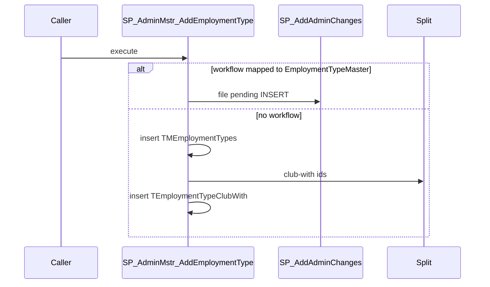
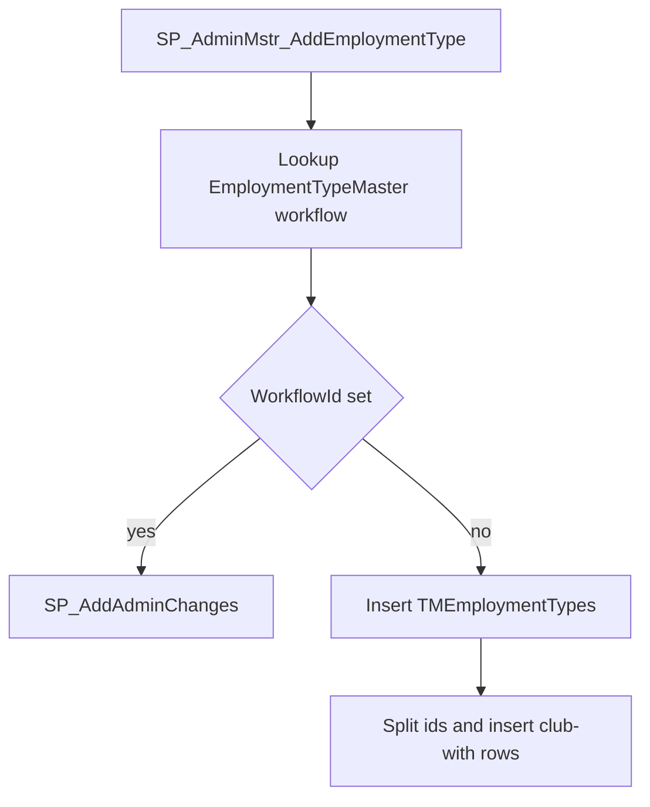

# SP_AdminMstr_AddEmploymentType

## What it does

Adds one employment type, or holds that insert for admin approval. It looks up a workflow whose mapped page is `EmploymentTypeMaster`. When that workflow exists, the XML includes the type and the comma-separated types it may convert to. When it does not, the procedure inserts `TMEmploymentTypes` and one `TEmploymentTypeClubWith` row per id in that list.

## Parameters

| Name | Direction | What it is for |
|---|---|---|
| `@EmploymentType` | in | Type name |
| `@IsActive` | in | Active flag |
| `@PrefixCharacter` | in | Whether an employee-number prefix is used |
| `@PrefixLetter` | in | Prefix text |
| `@CreatedBy` | in | Administrator |
| `@Employerid` | in | Organisation |
| `@EmploymentTypeClubWithId` | in | Comma-separated employment type ids this type may convert to |
| `@IsConfirmed` | in | Mark the type as confirmed. Default `N` |
| `@ProbationPeriodMonths` | in | Probation length |
| `@RetirementAge` | in | Retirement age |
| `@IsEndOfContractApplicable` | in | End-of-contract reminder applies |
| `@ReminderDaysBeforeEndOfContract` | in | Days before contract end |

All parameters are inputs.

## Call sequence

## Callers

No other procedure or function calls this object.

`SetupMasterDAL.AddEmploymentType` calls it from the Setup Masters page.

## Nested

| Object | Kind | When | Page |
|---|---|---|---|
| `SP_AddAdminChanges` | procedure | when a live `EmploymentTypeMaster` workflow exists | [SP_AddAdminChanges](/docs/database/hrms/SP_AddAdminChanges) |
| `Split` | function | when no workflow exists, to split `@EmploymentTypeClubWithId` | [Split](/docs/database/hrms/Split) |

## Steps

1. Read `WorkflowId` for module page `EmploymentTypeMaster`, this employer, `IsDelete = 0` (`SP_AdminMstr_AddEmploymentType.sql`).
2. When that id is set, build XML that names `TMEmploymentTypes` and `TEmploymentTypeClubWith`, then `EXEC SP_AddAdminChanges` with action `INSERT` and page `Employment Type Master`.
3. Otherwise insert `TMEmploymentTypes` and take `SCOPE_IDENTITY()`.
4. `dbo.Split` `@EmploymentTypeClubWithId` and insert one `TEmploymentTypeClubWith` row per value.

## Tables

| Table | Read or write |
|---|---|
| `TWorkflowManagement` | read |
| `TModulePages` | read |
| `TMEmploymentTypes` | write, when no workflow |
| `TEmploymentTypeClubWith` | write, when no workflow |
| `TAdminChangesApprovals` | write, through `SP_AddAdminChanges` |
| `TAdminChangesApprovalDetails` | write, through `SP_AddAdminChanges` |

## Flow

