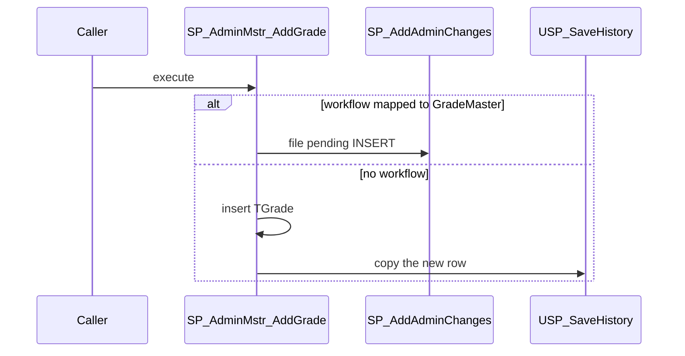
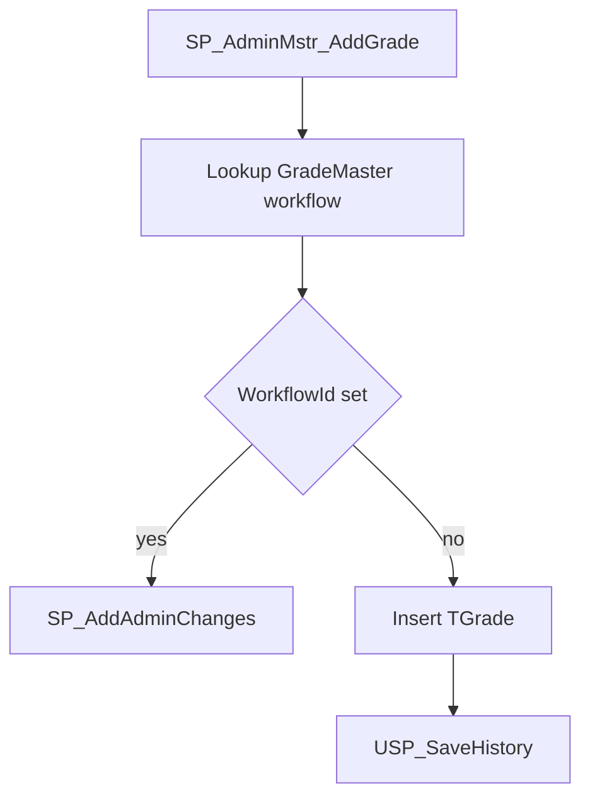

# SP_AdminMstr_AddGrade

## What it does

Adds one grade, or holds that insert for admin approval. It looks up a workflow whose mapped page is `GradeMaster`. When that workflow exists, it files a pending insert. When it does not, it inserts `TGrade` and calls `USP_SaveHistory`.

## Parameters

| Name | Direction | What it is for |
|---|---|---|
| `@GradeName` | in | Grade name |
| `@GradeDesc` | in | Description |
| `@GradeBand` | in | Band |
| `@IsActive` | in | Active flag |
| `@CreatedBy` | in | Administrator |
| `@Employerid` | in | Organisation |

All parameters are inputs.

## Call sequence

## Callers

No other procedure or function calls this object.

`SetupMasterDAL.AddGradeMaster` calls it from the Setup Masters page.

## Nested

| Object | Kind | When | Page |
|---|---|---|---|
| `SP_AddAdminChanges` | procedure | when a live `GradeMaster` workflow exists | [SP_AddAdminChanges](/docs/database/hrms/SP_AddAdminChanges) |
| `USP_SaveHistory` | procedure | when no workflow exists, after the insert | No page yet |

## Steps

1. Read `WorkflowId` for module page `GradeMaster`, this employer, `IsDelete = 0` (`SP_AdminMstr_AddGrade.sql`).
2. When that id is set, build `@ApprovalDetails` XML and `EXEC SP_AddAdminChanges` with action `INSERT`, page `Grade Master`, and request type `GradeMaster`.
3. Otherwise insert `TGrade` and `EXEC USP_SaveHistory` for `TGrade_History` with action `I`.

## Tables

| Table | Read or write |
|---|---|
| `TWorkflowManagement` | read |
| `TModulePages` | read |
| `TGrade` | write, when no workflow |
| `TAdminChangesApprovals` | write, through `SP_AddAdminChanges` |
| `TAdminChangesApprovalDetails` | write, through `SP_AddAdminChanges` |

## Flow

