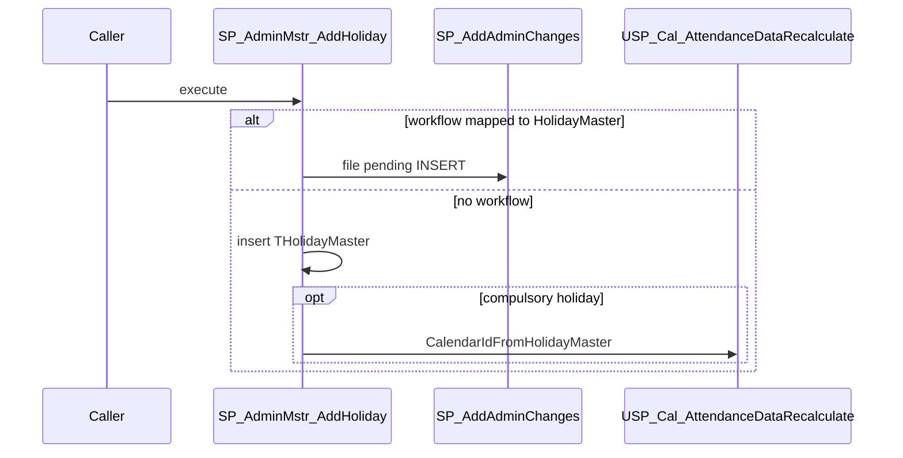
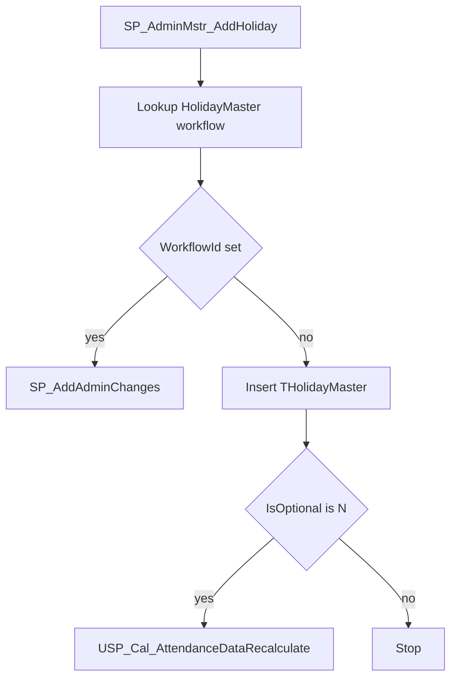

# SP_AdminMstr_AddHoliday

## What it does

Adds one holiday on a calendar, or holds that insert for admin approval. It looks up a workflow whose mapped page is `HolidayMaster`. When that workflow exists, it files a pending insert. When it does not, it inserts `THolidayMaster`. A compulsory holiday (`@IsOptional = 'N'`) then queues an attendance recalculation for that calendar and date.

## Parameters

| Name | Direction | What it is for |
|---|---|---|
| `@CalendarId` | in | Calendar the holiday belongs to |
| `@HolidayDate` | in | Holiday date |
| `@HolidayDesc` | in | Holiday name |
| `@HolidayReason` | in | Reason |
| `@IsActive` | in | Active flag |
| `@CreatedBy` | in | Administrator |
| `@Employerid` | in | Organisation |
| `@IsOptional` | in | `N` is compulsory. Any other value is optional |
| `@IsSelectiveHalfDay`, `@FirstHalf`, `@SecondHalf` | in | Half-day holiday |
| `@IsMinAttendanceRequired`, `@MinAttendanceDuration` | in | Minimum attendance required on that day |

All parameters are inputs.

## Call sequence

## Callers

No other procedure or function calls this object.

`SetupMasterDAL.AddHolidayMaster` calls it from the Setup Masters page.

## Nested

| Object | Kind | When | Page |
|---|---|---|---|
| `SP_AddAdminChanges` | procedure | when a live `HolidayMaster` workflow exists | [SP_AddAdminChanges](/docs/database/hrms/SP_AddAdminChanges) |
| `USP_Cal_AttendanceDataRecalculate` | procedure | when no workflow exists and `@IsOptional` is `N` | [USP_Cal_AttendanceDataRecalculate](/docs/database/hrms/USP_Cal_AttendanceDataRecalculate) |

## Steps

1. Build `@ApprovalDetails` XML for the holiday fields (`SP_AdminMstr_AddHoliday.sql`).
2. Read `WorkflowId` from `TWorkflowManagement` for module page `HolidayMaster`, this employer, `IsDelete = 0`.
3. When that id is set, `EXEC SP_AddAdminChanges` with action `INSERT`, page `Holiday Master`, and request type `HolidayMaster`.
4. Otherwise insert `THolidayMaster`.
5. When `@IsOptional` is `N`, `EXEC USP_Cal_AttendanceDataRecalculate` with entity type `CalendarIdFromHolidayMaster`, entity id `@CalendarId`, and from/to dates equal to `@HolidayDate`.

## Tables

| Table | Read or write |
|---|---|
| `TWorkflowManagement` | read |
| `TModulePages` | read |
| `THolidayMaster` | write, when no workflow |
| `TAdminChangesApprovals` | write, through `SP_AddAdminChanges` |
| `TAdminChangesApprovalDetails` | write, through `SP_AddAdminChanges` |

## Flow

