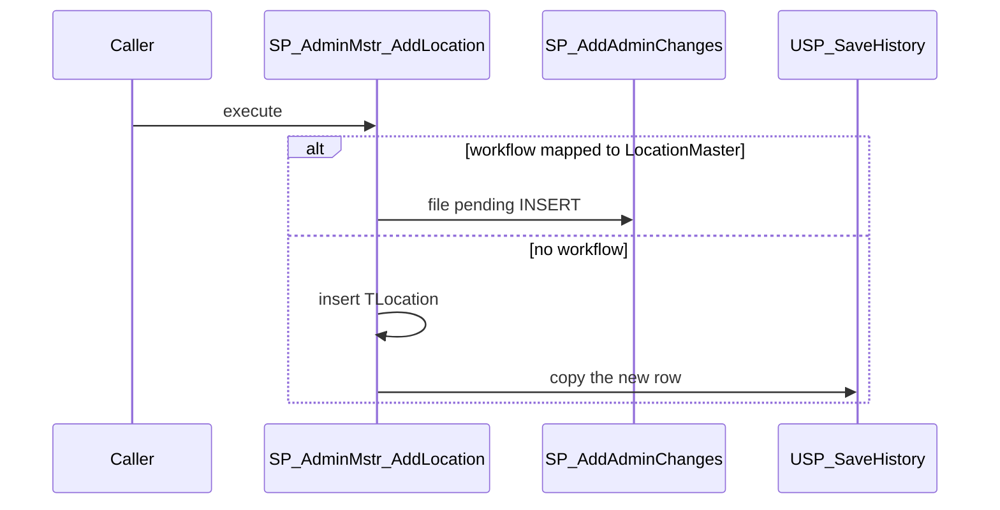
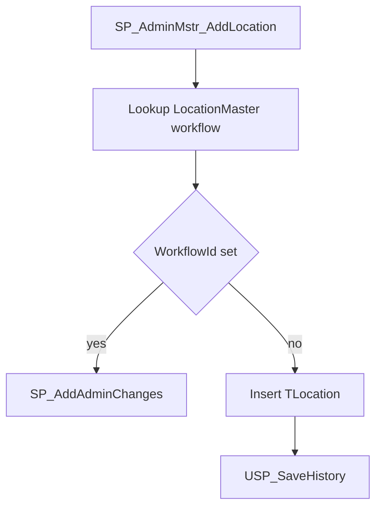

# SP_AdminMstr_AddLocation

## What it does

Adds one office location, or holds that insert for admin approval. It looks up a workflow whose mapped page is `LocationMaster`. When that workflow exists, it files a pending insert. When it does not, it inserts `TLocation` and calls `USP_SaveHistory`.

## Parameters

| Name | Direction | What it is for |
|---|---|---|
| `@LocationName` | in | Location name |
| `@CountryId` | in | Country |
| `@Address1`, `@Address2`, `@ZipCode` | in | Address |
| `@PhoneNumber`, `@Fax`, `@OtherPhoneNumber`, `@OtherFax` | in | Contact numbers |
| `@IsActive` | in | Active flag |
| `@CreatedBy` | in | Administrator |
| `@Employerid` | in | Organisation |
| `@TimeZone`, `@TimeZoneId` | in | Time zone label and id |

All parameters are inputs.

## Call sequence

## Callers

No other procedure or function calls this object.

`SetupMasterDAL.AddLocation` calls it from the Setup Masters page.

## Nested

| Object | Kind | When | Page |
|---|---|---|---|
| `SP_AddAdminChanges` | procedure | when a live `LocationMaster` workflow exists | [SP_AddAdminChanges](/docs/database/hrms/SP_AddAdminChanges) |
| `USP_SaveHistory` | procedure | when no workflow exists, after the insert | No page yet |

## Steps

1. Read `WorkflowId` from `TWorkflowManagement` for module page `LocationMaster`, this employer, `IsDelete = 0` (`SP_AdminMstr_AddLocation.sql`).
2. When that id is set, build `@ApprovalDetails` XML and `EXEC SP_AddAdminChanges` with action `INSERT`, page `Location Master`, and request type `LocationMaster`.
3. Otherwise insert `TLocation` and `EXEC USP_SaveHistory` for `TLocation_History` with action `I`.

## Tables

| Table | Read or write |
|---|---|
| `TWorkflowManagement` | read |
| `TModulePages` | read |
| `TLocation` | write, when no workflow |
| `TAdminChangesApprovals` | write, through `SP_AddAdminChanges` |
| `TAdminChangesApprovalDetails` | write, through `SP_AddAdminChanges` |

## Flow

