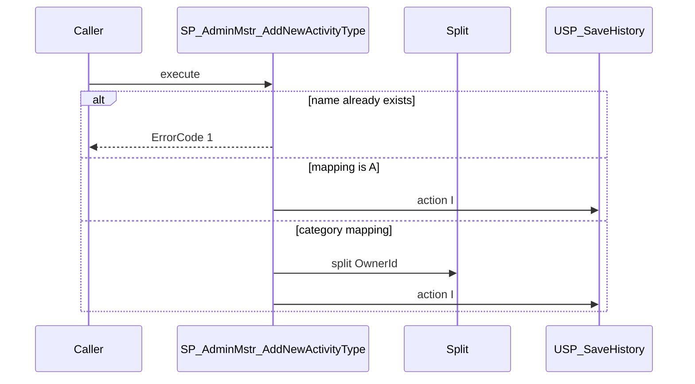
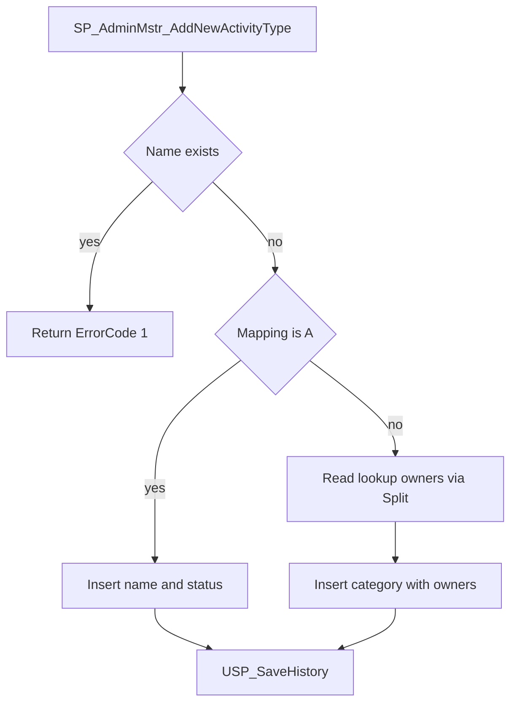

# SP_AdminMstr_AddNewActivityType

## What it does

Inserts one clearance category (`TActivityType`) for an employer. A category with the same name for that employer returns `ErrorCode` 1 and does not insert. When clearance approver mapping is `A`, only the name and status are stored. Otherwise the procedure also stores the owner text, owner ids, and an owner-role string built from `TLOOKUP`.

## Parameters

| Name | Direction | What it is for |
|---|---|---|
| `@activityType` | in | Category name, `varchar(50)` |
| `@CreatedBy` | in | Employee who added the category |
| `@Employerid` | in | Organisation |
| `@IsActive` | in | Active flag, `char(1)` |
| `@ClearanceApproverMapping` | in | `A` for activity-level owners, otherwise category-level owners |
| `@ActivityOwner` | in | Owner display text. Used when mapping is not `A` |
| `@ActivityOwnerId` | in | Owner id text. Used when mapping is not `A` |
| `@OwnerId` | in | Comma-separated lookup ids used to build `OwnerType` |

## Call sequence

## Callers

No other procedure or function calls this object.

## Nested

| Object | Kind | When | Page |
|---|---|---|---|
| `Split` | function | when `@ClearanceApproverMapping` is not `A` | [Split](/docs/database/hrms/Split) |
| `USP_SaveHistory` | procedure | after a successful insert | No page yet |

`USP_SaveHistory` is executed by name. Its script is not in `HRMS-DATABASE`.

## Steps

1. If `TActivityType` already has this name for the employer, select `ErrorCode` 1 and the message `Clearance category with same name already exist`, and stop.

2. When `@ClearanceApproverMapping` is `A`, insert name, created-by, created date, employer, and `IsActive`.

3. Otherwise read `TLOOKUP.AdditionalInfo` for the ids returned by `dbo.Split` on `@OwnerId`, concatenate them, and insert the category with `ActivityOwner`, `ActivityOwnerId`, and `OwnerType`.

4. Execute `USP_SaveHistory` for `TActivityType` / `TActivityType_History` with action `I` and the new `ActivityTypeID`.

## Tables

| Table | Read or write |
|---|---|
| `TActivityType` | read for the duplicate check, write on insert |
| `TLOOKUP` | read when mapping is not `A` |

## Flow

