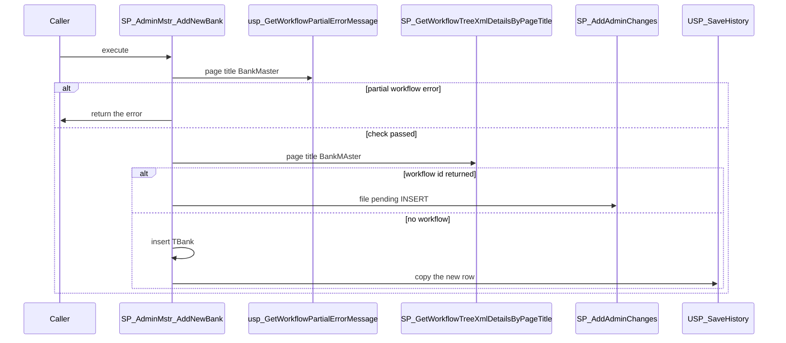
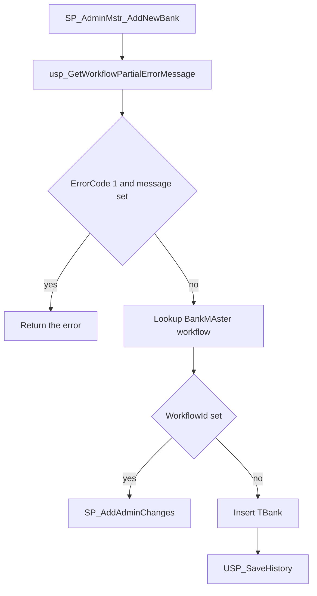

# SP_AdminMstr_AddNewBank

## What it does

Adds one bank, or holds that insert for admin approval. It first asks whether the `BankMaster` workflow is only partly configured, and stops when that check returns an error. It then loads the workflow with page title `BankMAster`. When a workflow id comes back, it files a pending insert. When it does not, it inserts `TBank` and calls `USP_SaveHistory`.

## Parameters

| Name | Direction | What it is for |
|---|---|---|
| `@bankName` | in | Bank name |
| `@CreatedBy` | in | Administrator |
| `@Employerid` | in | Organisation |
| `@IsActive` | in | `Y` or `N` |

All parameters are inputs.

## Call sequence

## Callers

No other procedure or function calls this object.

`SetupMasterDAL.AddBank` calls it from the Setup Masters page.

## Nested

| Object | Kind | When | Page |
|---|---|---|---|
| `usp_GetWorkflowPartialErrorMessage` | procedure | before the workflow lookup, page title `BankMaster` | [usp_GetWorkflowPartialErrorMessage](/docs/database/hrms/usp_GetWorkflowPartialErrorMessage) |
| `SP_GetWorkflowTreeXmlDetailsByPageTitle` | procedure | when the partial check does not stop the procedure, page title `BankMAster` | [SP_GetWorkflowTreeXmlDetailsByPageTitle](/docs/database/hrms/SP_GetWorkflowTreeXmlDetailsByPageTitle) |
| `SP_AddAdminChanges` | procedure | when that lookup returns a workflow id | [SP_AddAdminChanges](/docs/database/hrms/SP_AddAdminChanges) |
| `USP_SaveHistory` | procedure | when no workflow id is returned, after the insert | No page yet |

## Steps

1. `INSERT...EXEC usp_GetWorkflowPartialErrorMessage` for `@Employerid` and page title `BankMaster` into `#WorkflowError` (`SP_AdminMstr_AddNewBank.sql`).
2. When a row has `ErrorCode` 1 and a non-empty `ErrorMsg`, return that row and stop.
3. `EXEC SP_GetWorkflowTreeXmlDetailsByPageTitle` for `BankMAster` and `@Employerid`.
4. When a workflow id is returned, `EXEC SP_AddAdminChanges` with action `INSERT`, page `Bank MAster`, and request type `BankMAster`.
5. Otherwise insert `TBank` and `EXEC USP_SaveHistory` for `TBank_history` with action `I`.

## Tables

| Table | Read or write |
|---|---|
| `TBank` | write, when no workflow |
| `TAdminChangesApprovals` | write, through `SP_AddAdminChanges` |
| `TAdminChangesApprovalDetails` | write, through `SP_AddAdminChanges` |

## Flow

