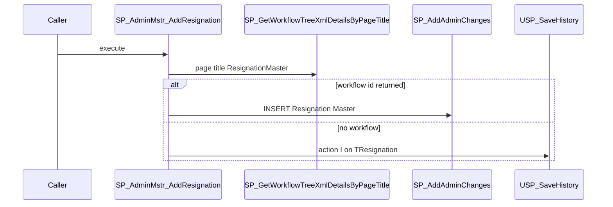
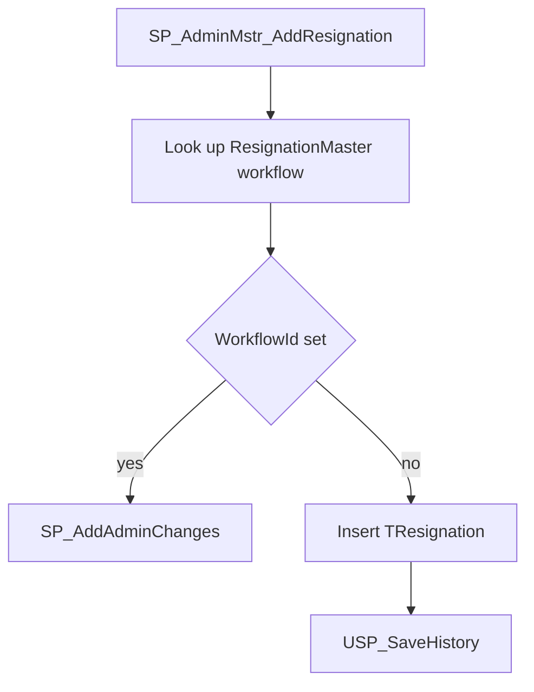

# SP_AdminMstr_AddResignation

## What it does

Adds one resignation reason for an employer, or holds it for admin approval. When a workflow is mapped to module page `ResignationMaster`, the procedure files an INSERT request and does not write `TResignation`. Otherwise it inserts the reason and asks `USP_SaveHistory` to copy the new row.

## Parameters

| Name | Direction | What it is for |
|---|---|---|
| `@ResignationDescription` | in | Reason text, `nvarchar(100)` |
| `@CreatedBy` | in | Employee who submitted the reason |
| `@Employerid` | in | Organisation |
| `@IsActive` | in | `Y` or `N` |

## Call sequence

## Callers

No other procedure or function calls this object.

## Nested

| Object | Kind | When | Page |
|---|---|---|---|
| `SP_GetWorkflowTreeXmlDetailsByPageTitle` | procedure | always, before the branch | [SP_GetWorkflowTreeXmlDetailsByPageTitle](/docs/database/hrms/SP_GetWorkflowTreeXmlDetailsByPageTitle) |
| `SP_AddAdminChanges` | procedure | when a workflow id is returned | [SP_AddAdminChanges](/docs/database/hrms/SP_AddAdminChanges) |
| `USP_SaveHistory` | procedure | when no workflow is mapped, after the insert | No page yet |

`USP_SaveHistory` is executed by name. Its script is not in `HRMS-DATABASE`.

## Steps

1. Load a workflow with `SP_GetWorkflowTreeXmlDetailsByPageTitle` for page title `ResignationMaster` and `@Employerid`.

2. When `WorkflowId` is not null, build XML of description, created-by, created date, employer, and status, all tagged as table `TResignation`. Execute `SP_AddAdminChanges` with action `INSERT`, page `Resignation Master`, request type `ResignationMaster`, and that workflow id.

3. Otherwise insert `TResignation` and execute `USP_SaveHistory` for `TResignation` / `TResignation_History` with action `I` and the new `ResignationId`.

## Tables

| Table | Read or write |
|---|---|
| `TResignation` | write, only when no workflow is mapped |

`SP_AddAdminChanges` writes the approval tables. This script does not.

## Flow

