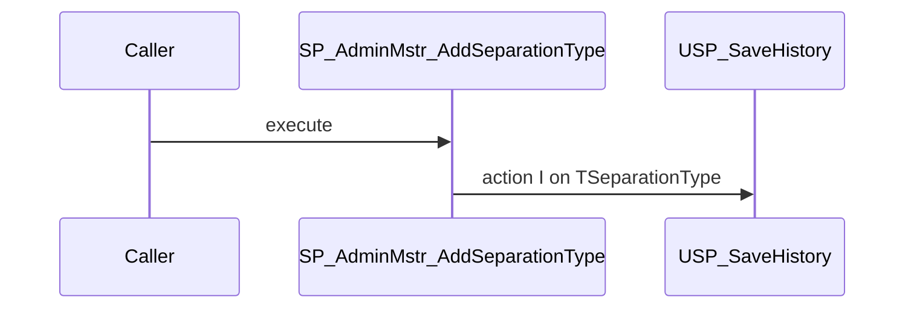
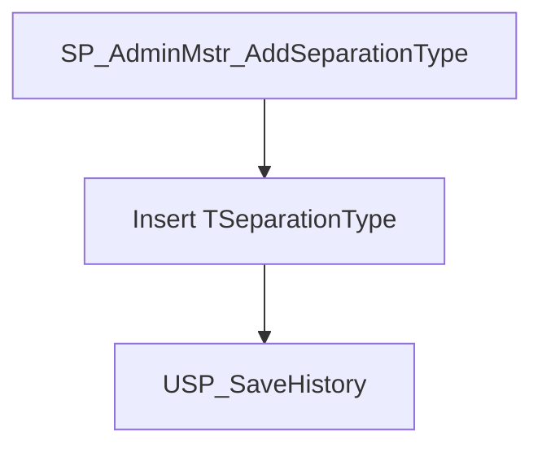

# SP_AdminMstr_AddSeparationType

## What it does

Inserts one separation type for an employer and asks `USP_SaveHistory` to copy the new row into `TSeparationType_History`. It does not check for a duplicate name and it does not file an approval request.

## Parameters

| Name | Direction | What it is for |
|---|---|---|
| `@SeparationTypeDescription` | in | Type name, `nvarchar(100)` |
| `@CreatedBy` | in | Employee who added the type |
| `@Employerid` | in | Organisation |
| `@Isactive` | in | Active flag, `char(1)` |

## Call sequence

## Callers

No other procedure or function calls this object.

## Nested

| Object | Kind | When | Page |
|---|---|---|---|
| `USP_SaveHistory` | procedure | after the insert | No page yet |

`USP_SaveHistory` is executed by name. Its script is not in `HRMS-DATABASE`.

## Steps

1. Insert `TSeparationType` with the description, created-by, `getdate()`, employer, and active flag.

2. Read `SCOPE_IDENTITY()` and execute `USP_SaveHistory` for `TSeparationType` / `TSeparationType_History` with action `I`.

## Tables

| Table | Read or write |
|---|---|
| `TSeparationType` | write |

## Flow

