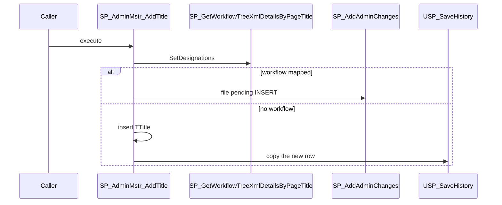
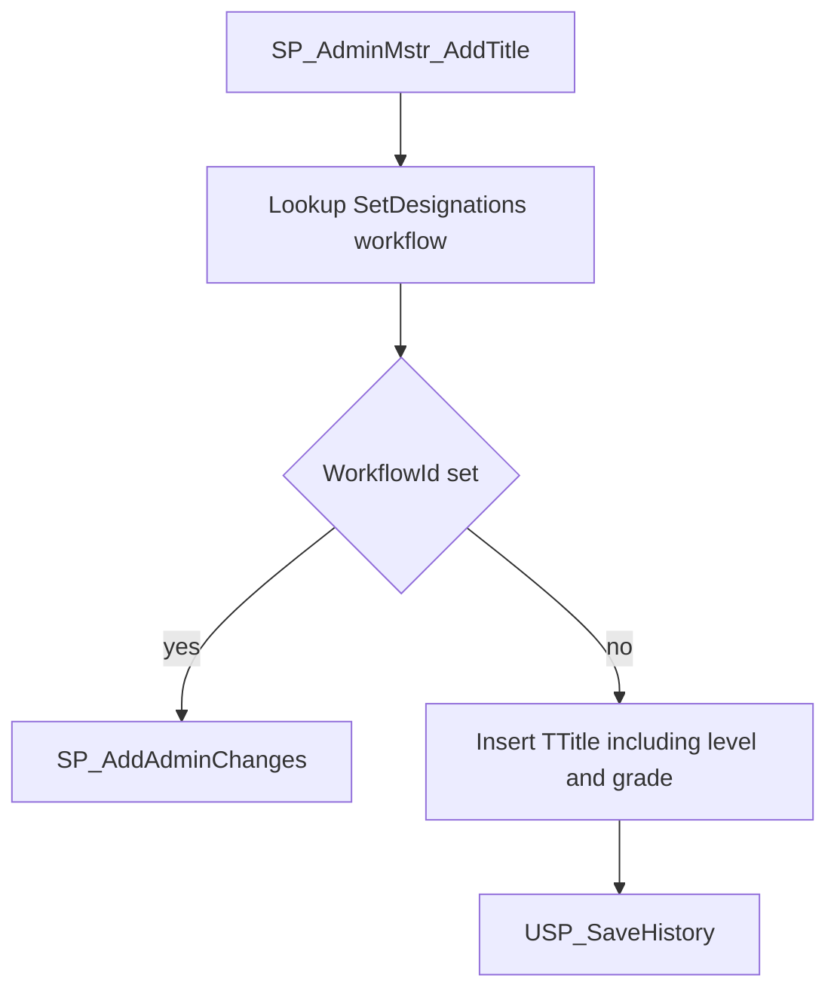

# SP_AdminMstr_AddTitle

## What it does

Adds one designation, or holds that insert for admin approval. It loads the workflow for module page `SetDesignations`. When that workflow exists, the pending XML covers title, description, status, and audit fields. It does not include designation level or grade. When no workflow exists, the insert writes those two columns as well, and then calls `USP_SaveHistory`.

## Parameters

| Name | Direction | What it is for |
|---|---|---|
| `@jobTitle` | in | Designation name |
| `@jobTitleDesc` | in | Description |
| `@IsActive` | in | `Y` or `N` |
| `@CreatedBy` | in | Administrator |
| `@Employerid` | in | Organisation |
| `@DesignationLevel` | in | Lookup id stored on the direct insert |
| `@Gradeid` | in | Grade. Default NULL |

All parameters are inputs.

## Call sequence

## Callers

| Object | Kind | Page |
|---|---|---|
| `Sp_RRS_InsertDetails` | procedure | No page yet |
| `Sp_RRS_UpdateDetails` | procedure | No page yet |
| `Sp_RRS_UpdateChildDetails` | procedure | No page yet |

`SetupMasterDAL.AddTitle` also calls it from the Setup Masters page.

## Nested

| Object | Kind | When | Page |
|---|---|---|---|
| `SP_GetWorkflowTreeXmlDetailsByPageTitle` | procedure | before the insert-or-approve branch | [SP_GetWorkflowTreeXmlDetailsByPageTitle](/docs/database/hrms/SP_GetWorkflowTreeXmlDetailsByPageTitle) |
| `SP_AddAdminChanges` | procedure | when that lookup returns a workflow id | [SP_AddAdminChanges](/docs/database/hrms/SP_AddAdminChanges) |
| `USP_SaveHistory` | procedure | when no workflow id is returned, after the insert | No page yet |

## Steps

1. `EXEC SP_GetWorkflowTreeXmlDetailsByPageTitle` for `SetDesignations` and `@Employerid` (`SP_AdminMstr_AddTitle.sql`).
2. When a workflow id is returned, build XML for title, description, status, created-by, created date, and employer, then `EXEC SP_AddAdminChanges` with action `INSERT` and page `Set Designations`.
3. Otherwise insert `TTitle`. `DesignationLevel` is the `Lookup_ID` from `TLOOKUP` that equals `@DesignationLevel`. `Gradeid` is stored as passed.
4. `EXEC USP_SaveHistory` for `TTitle_History` with action `I`.

## Tables

| Table | Read or write |
|---|---|
| `TLOOKUP` | read, on the direct insert |
| `TTitle` | write, when no workflow |
| `TAdminChangesApprovals` | write, through `SP_AddAdminChanges` |
| `TAdminChangesApprovalDetails` | write, through `SP_AddAdminChanges` |

## Flow

