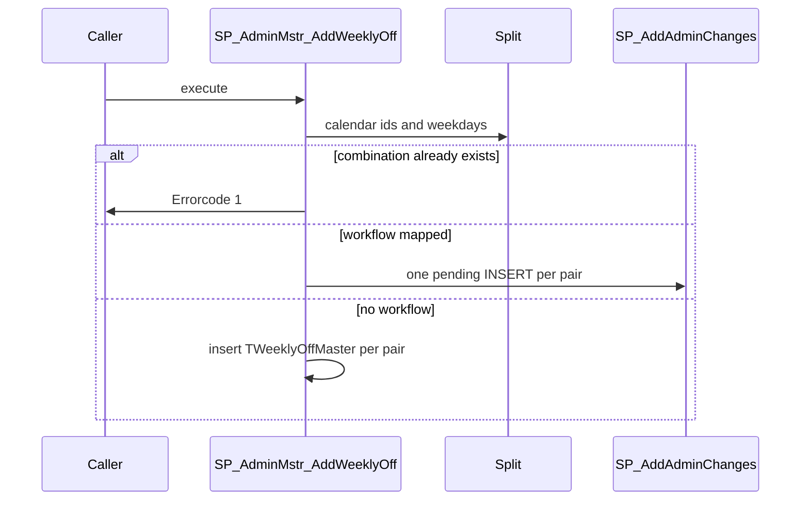
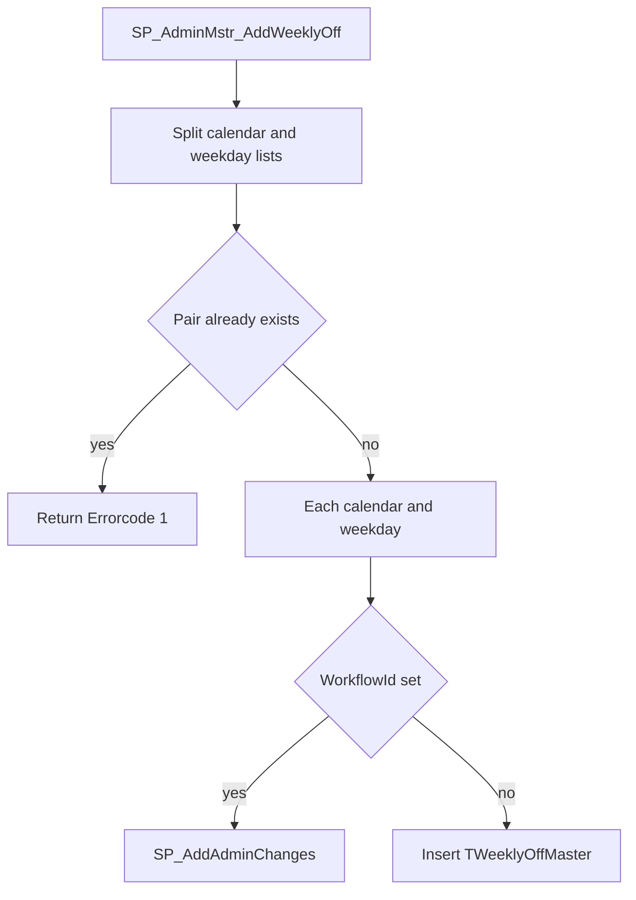

# SP_AdminMstr_AddWeeklyOff

## What it does

Adds weekly-off days for one or more calendars. `@CalendarId` and `@WeekDay` are comma-separated lists. If any of those calendar, weekday, and week-number combinations already exists for the employer, the procedure returns `Errorcode` 1 and inserts nothing. Otherwise it writes one row, or one pending admin change, for each calendar and weekday pair.

## Parameters

| Name | Direction | What it is for |
|---|---|---|
| `@CalendarId` | in | Comma-separated calendar ids |
| `@WeekNumber` | in | Week code, such as `All` or `1` |
| `@WeekDay` | in | Comma-separated weekdays |
| `@IsHalfDay` | in | Half-day weekly off |
| `@IsActive` | in | Active flag |
| `@CreatedBy` | in | Administrator |
| `@Employerid` | in | Organisation |
| `@FirstHalf`, `@SecondHalf` | in | Which half, when the day is a half day. Default 0 |

All parameters are inputs.

## Call sequence

## Callers

No other procedure or function calls this object.

`SetupMasterDAL.AddWeeklyOffMaster` calls it from the Setup Masters page.

## Nested

| Object | Kind | When | Page |
|---|---|---|---|
| `Split` | function | to split `@CalendarId` and `@WeekDay` | [Split](/docs/database/hrms/Split) |
| `SP_AddAdminChanges` | procedure | for each pair when a live `WeeklyOffMaster` workflow exists | [SP_AddAdminChanges](/docs/database/hrms/SP_AddAdminChanges) |

## Steps

1. Read `WorkflowId` for module page `WeeklyOffMaster`, this employer, `IsDelete = 0` (`SP_AdminMstr_AddWeeklyOff.sql`).
2. Split `@CalendarId` and `@WeekDay` with `dbo.Split`.
3. Count existing `TWeeklyOffMaster` rows for those calendars, weekdays, week number, and employer.
4. When the count is greater than zero, return `Errorcode` 1 and a message that names the calendar and weekday. Do not insert.
5. Otherwise loop each calendar and each weekday. When a workflow id is set, `EXEC SP_AddAdminChanges` with action `INSERT` and page `Weekly Off Master`. Otherwise insert `TWeeklyOffMaster`.

## Tables

| Table | Read or write |
|---|---|
| `TWorkflowManagement` | read |
| `TModulePages` | read |
| `TWeeklyOffMaster` | read, and write when no workflow |
| `TCalendarMaster` | read, in the duplicate-name message |
| `TAdminChangesApprovals` | write, through `SP_AddAdminChanges` |
| `TAdminChangesApprovalDetails` | write, through `SP_AddAdminChanges` |

## Flow

