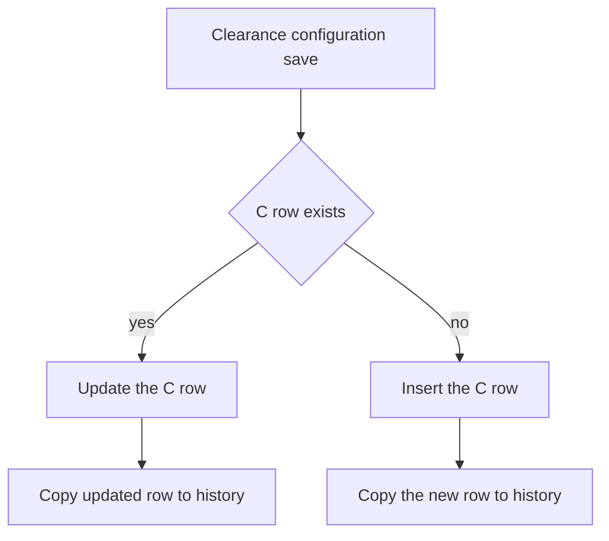

# SP_AdminMstr_ClearanceConfigurationData_SaveUpdate

## What it does

Saves clearance configuration for one employer on `TResignationConfigurationData` with `ConfigurationType` `C`. An existing row is updated and then copied to history. A missing row is inserted, and that new row is copied to history. `NextExecutionDate` is set to tomorrow.

## Parameters

| Name | Direction | What it is for |
|---|---|---|
| `@EmployerId` | in | Organisation |
| `@SendReminderForDueClearance` | in | Send a reminder for due clearance |
| `@ReminderFrequency` | in | Frequency code, `char(1)` |
| `@AllowClearanceDueDateOnWeekendHoliday` | in | Allow a due date on a weekend or holiday |
| `@ClearanceApproverMapping` | in | Category or activity mapping text |
| `@CreatedBy` | in | Employee who saved the configuration |

## Call sequence

Calls no other procedures or functions.

## Callers

No other procedure or function calls this object.

## Nested

Calls no other procedures or functions.

## Steps

1. When a `ConfigurationType` `C` row exists, update reminder, weekend, mapping, `NextExecutionDate`, `ModifiedBy`, and `ModifiedDate`, then insert the updated row into `TResignationConfigurationData_History`.

2. Otherwise insert a new `C` row with `NextExecutionDate` of tomorrow and copy that row into history.

## Tables

| Table | Read or write |
|---|---|
| `TResignationConfigurationData` | read and write |
| `TResignationConfigurationData_History` | write |

## Flow

