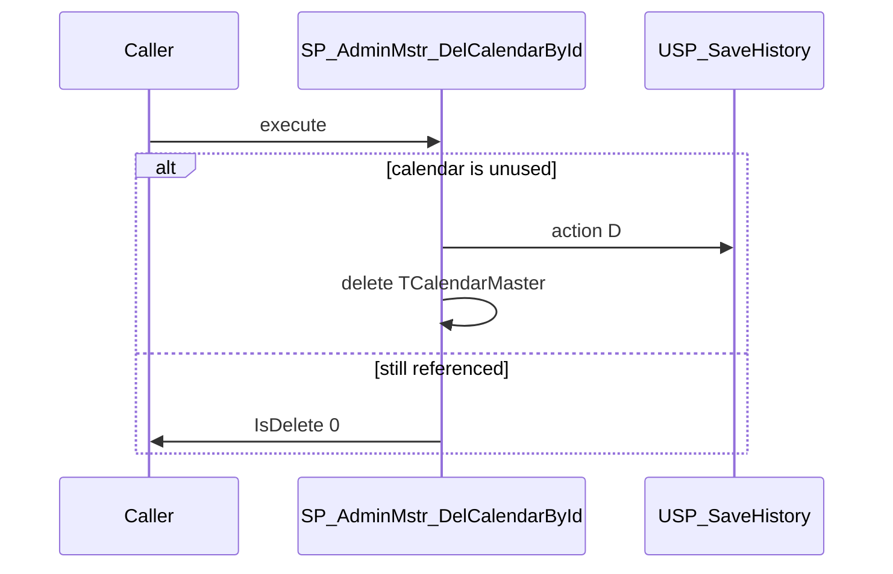
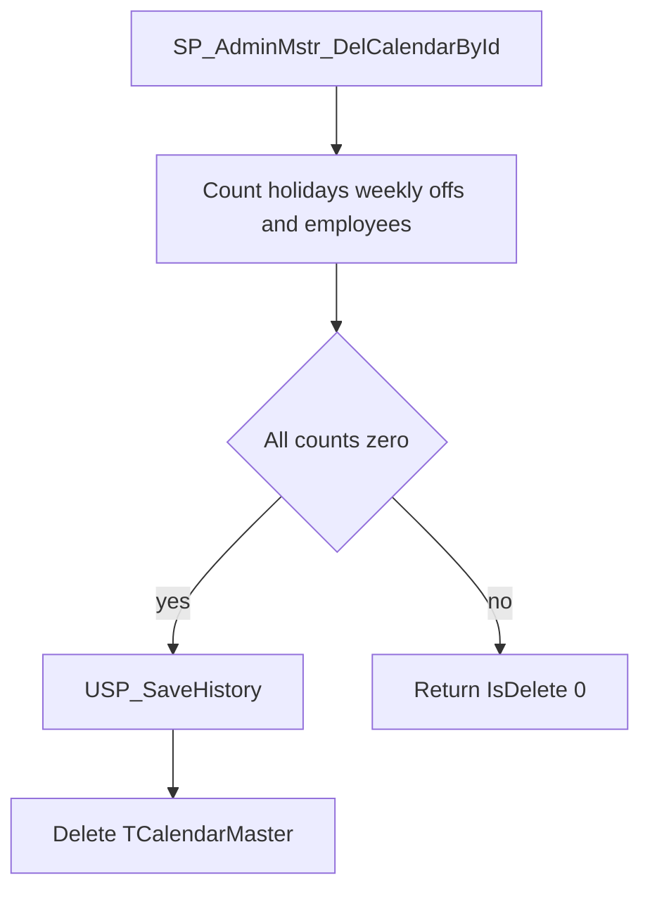

# SP_AdminMstr_DelCalendarById

## What it does

Deletes one calendar only when no holiday, weekly off, employee, or employee-history row still points at it. The history call uses created-by `-1`. The procedure does not look up a workflow.

## Parameters

| Name | Direction | What it is for |
|---|---|---|
| `@CalendarId` | in | Calendar to delete |

## Call sequence

## Callers

No other procedure or function calls this object.

`SetupMasterDAL.DeleteCalendarMaster` calls it from the Setup Masters page.

## Nested

| Object | Kind | When | Page |
|---|---|---|---|
| `USP_SaveHistory` | procedure | when holiday, weekly off, employee, and employee-history counts are all zero | No page yet |

## Steps

1. Count `THolidayMaster`, `TWeeklyOffMaster`, `TEmployeeInfo`, and `TEmployeeInfoHistory` for `@CalendarId` (`SP_AdminMstr_DelCalendarById.sql`).
2. When every count is zero, `EXEC USP_SaveHistory` with action `D` and history created-by `-1`, then delete `TCalendarMaster` and return `IsDelete` 1.
3. Otherwise return `IsDelete` 0.

## Tables

| Table | Read or write |
|---|---|
| `THolidayMaster` | read |
| `TWeeklyOffMaster` | read |
| `TEmployeeInfo` | read |
| `TEmployeeInfoHistory` | read |
| `TCalendarMaster` | write, when unused |

## Flow

